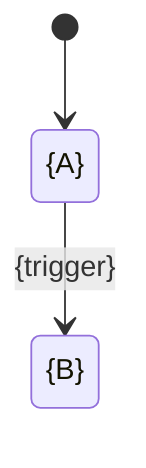

<!-- GENERATED by tools/hub.py sync from skills/software-component/references/templates/data-dictionary.md; edit the source -->
# Data Dictionary — {Module}

**Module**: {NN} {Module name}
**Owner**: {service that owns this schema}
**Version**: {X.Y}
**Date**: YYYY-MM-DD
**Source**: {how it was produced, e.g. generated from the schema dump of {environment} on YYYY-MM-DD}

> {one paragraph: what this module stores and who writes it}

Path: `DB/Data Dictionary/{NN}_{Module}.md`, same `{NN}` as the ER diagram file. Regenerate together with the ER
diagram and both indexes; counts in the indexes must match. Old versions move to `_deprecated_v{n}/`.
Example values are placeholders, never production data.

## Tables ({n})

| # | Table |
|---|---|
| {NN}.1 | [`{table}`](#{nn}1-{table}) |

---

## {NN}.1 {table}

> **Meaning**: {what one row is}
> `PK {column}` · `Unique {columns}` · ~{n} rows ({environment})

| Field | Type | Constraints | Description | Example |
|---|---|---|---|---|
| `{id}` | {uuid / bigint} | PK | {...} | `{placeholder}` |
| `{fk_id}` | {type} | FK → `{other_table}.{id}`, NOT NULL | {...} | `{placeholder}` |
| `{status}` | {varchar(32)} | NOT NULL, DEFAULT `'{VALUE}'`, CHECK in ({values}) | {...} | `{VALUE}` |

Constraint order in the cell: PK → FK → UNIQUE → NOT NULL → DEFAULT → CHECK.

### 🔄 Life Cycle (only for state-machine columns)

| From | To | Trigger |
|---|---|---|
| `{A}` | `{B}` | {event / service} |

### Seeded values (lookup / master tables only)

| code | label | sort_order |
|---|---|---|
| `{CODE}` | {label} | {n} |

---

## Index file `DB/Data Dictionary/DATA_DICT.md`

| # | Module | File | Owner | Tables |
|---|---|---|---|---|
| {NN} | {Module} | [{NN}_{Module}.md](./{NN}_{Module}.md) | {service} | {n} |
| | **Total** | | | **{n}** |

Per-table index: `| # | Table (link) | Description |`.
