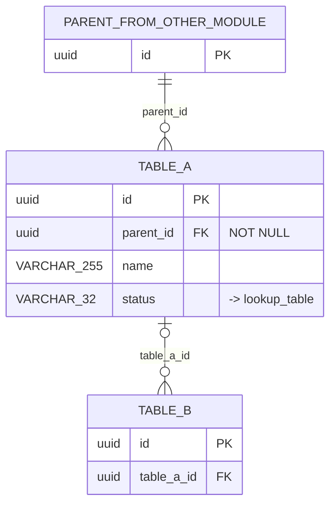

<!-- GENERATED by tools/hub.py sync from skills/software-component/references/templates/er-diagram.md; edit the source -->
# ER Diagram — {Module}

**Module**: {NN} {Module name}
**Owner**: {service}
**Version**: {X.Y}
**Date**: YYYY-MM-DD
**Source**: [Data Dictionary {NN}_{Module}](../Data%20Dictionary/{NN}_{Module}.md)

> {หนึ่งย่อหน้า: entity ใน module นี้และความสัมพันธ์หลัก}

Path: `DB/ER Diagrams/{NN}_{Module}.md` สะท้อนไฟล์ data dictionary ที่มี `{NN}` เดียวกัน

## Diagram

กฎ (แทน `TABLE_A`, `parent_id` และชื่อตัวอย่างอื่นด้วยชื่อจริง):
- type เขียนเป็น token (`VARCHAR_255`, `NUMERIC_12_2`); key ระบุ `PK` / `FK`; หมายเหตุ constraint อยู่ในเครื่องหมายคำพูด
- `||--o{` เมื่อ FK เป็น NOT NULL, `|o--o{` เมื่อเป็น nullable; label ของเส้นคือชื่อ column FK
- parent จาก module อื่นแสดงเป็น entity stub ที่มีเฉพาะ PK
- FK ไป lookup / master table เป็น annotation (`"-> table"`) ไม่ใช่เส้น

## Cross-module FKs

| From (this module) | Column | To (module.table) |
|---|---|---|
| `{table}` | `{fk_id}` | {NN}.`{table}` |

## Lookup / Master References

| Table | Column | Lookup table |
|---|---|---|

---

## Index file `DB/ER Diagrams/ER_DIAGRAMS.md`

| # | Module | File | Entities | Relationships | Lookup refs |
|---|---|---|---|---|---|
| {NN} | {Module} | [{NN}_{Module}.md](./{NN}_{Module}.md) | {n} | {n} | {n} |
