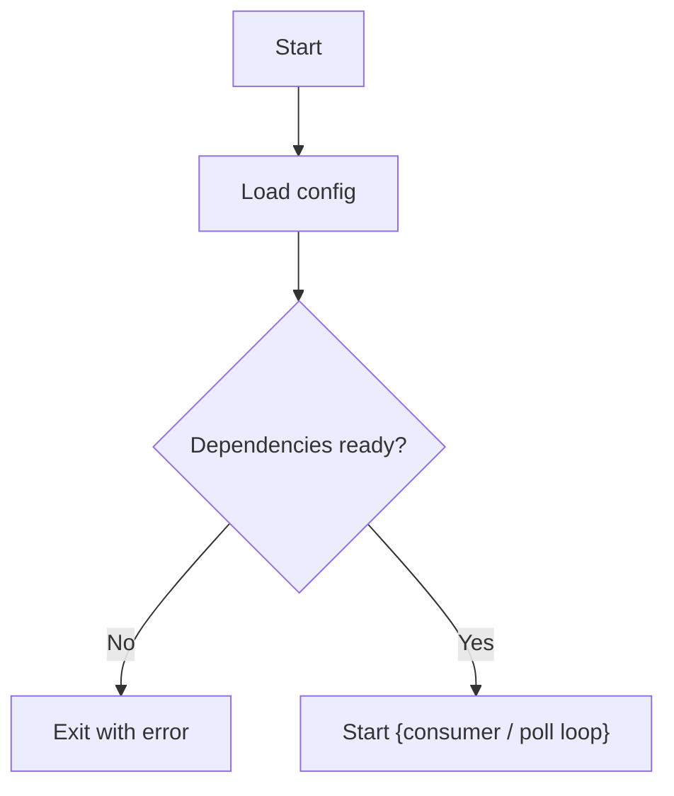
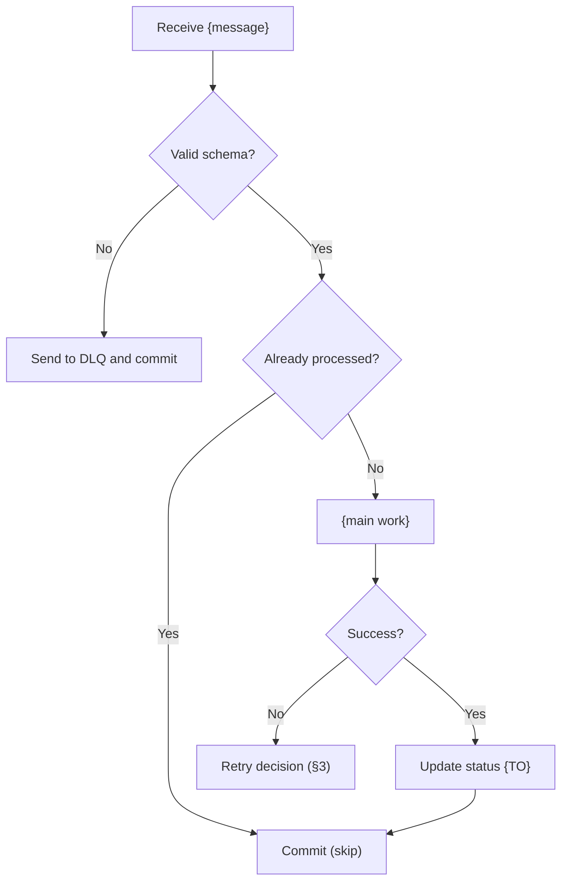
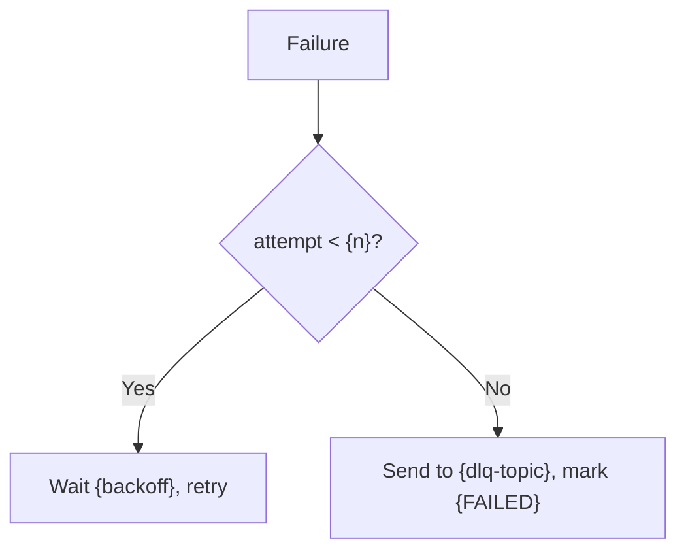
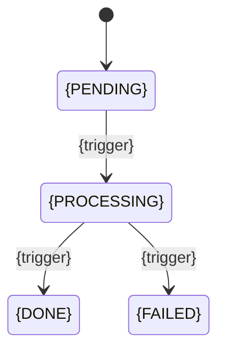
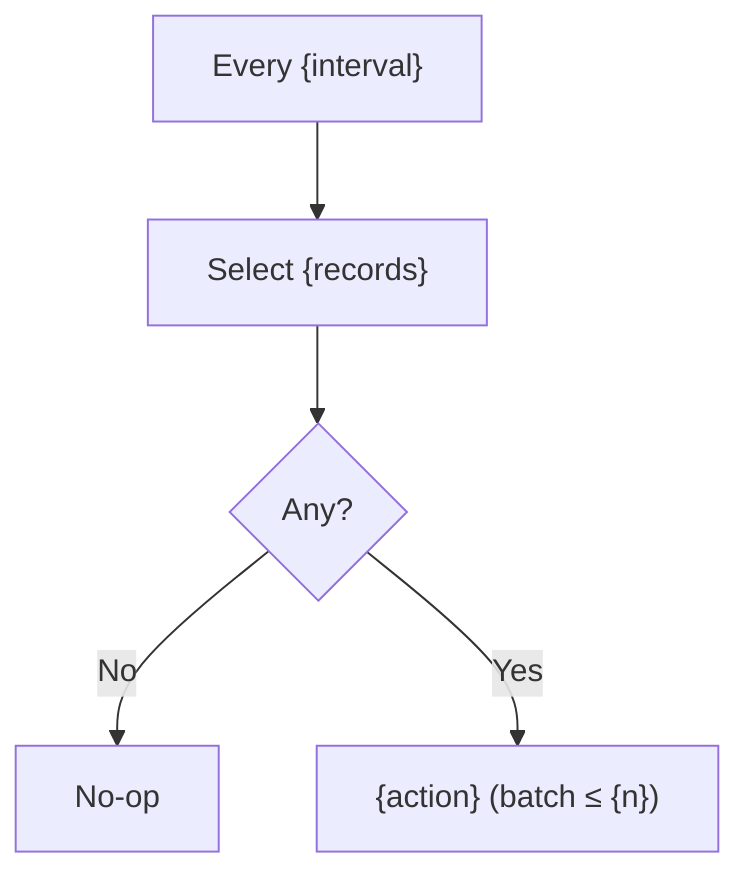
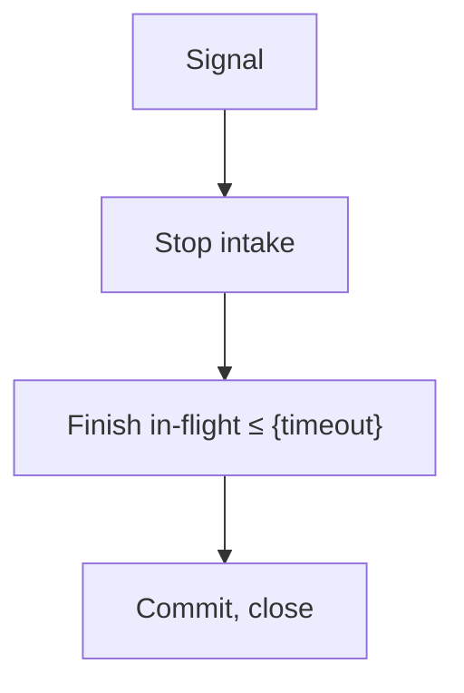
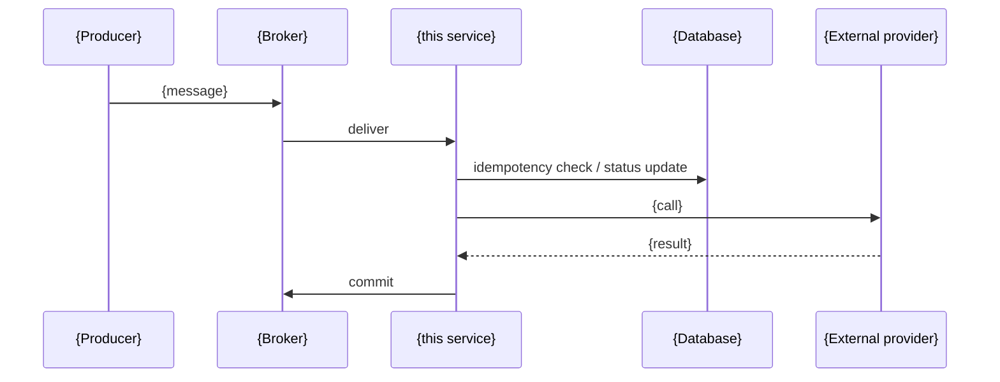

<!-- GENERATED by tools/hub.py sync from skills/software-component/references/templates/service-flowchart.md; edit the source -->
# {service-name} — Flowcharts

| Version | Date | Spec |
|---|---|---|
| {X.Y.Z} | YYYY-MM-DD | [{service}-spec.md](../{service}-spec/{service}-spec.md) |

Path: `<service>/<service>-flowchart/<service>-flowchart.md`. One section per spec section that has logic; same
version and date as the spec. Mermaid syntax follows the renderer the team uses.

## 1. Startup

## 2. Main Loop (spec §5)

## 3. Retry / DLQ Decision (spec §7)

## 4. Status Lifecycle (spec §9)

## 5. Scheduled Jobs (spec §10)

## 6. Graceful Shutdown (spec §14)

## 7. Service Interaction

