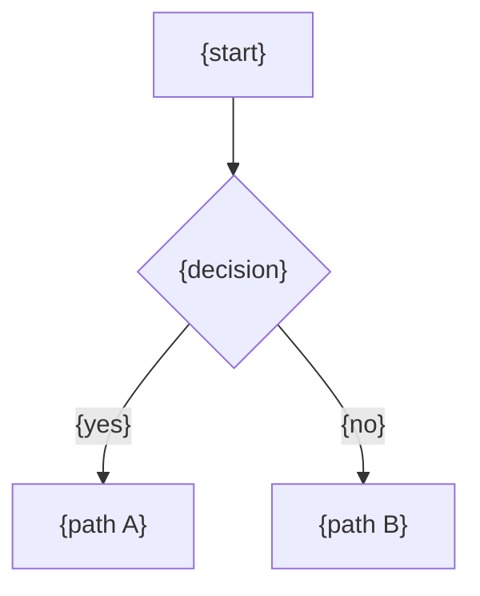
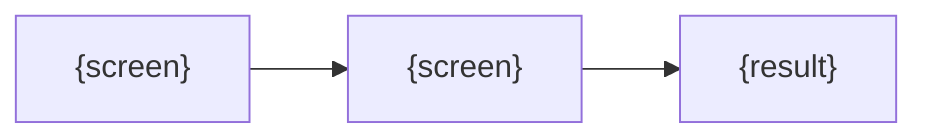

<!-- GENERATED by tools/hub.py sync from skills/swc/references/templates/workflow.md; edit the source -->
# Workflow — {Business process}

**Project**: {project}
**Last Updated**: YYYY-MM-DD
**Scope**: {per organization / per user / system-wide}
**Level**: {business / technical}
**Tables**: [`{table}`]({relative link to data dictionary section})

Path: `Workflow/{Process}.md`. One file per cross-cutting business process (one source; no copies elsewhere). Pages,
endpoints and services link here instead of re-explaining the process.

## 1. Overview

{one paragraph}

## 2. Status Lifecycle

| Status | Meaning | Editable? | Cancellable? | Deletable? |
|---|---|---|---|---|
| `{DRAFT}` | {...} | ✅ | ✅ | ✅ |
| `{ACTIVE}` | {...} | ❌ | ⚠️ {condition} | ❌ |

## 3. Permissions

| Action | {Role A} | {Role B} | {Role C} | {Role D} | Notes |
|---|---|---|---|---|---|
| {action} | ✅ | ✅ | ⚠️ | ❌ | {condition} |

## 4. Screen Flow

## 5. Paths (step by step)

### Path A — {name}
1. {actor} {action} → {system effect}

### Path B — {name}

## 6. Sources / Inputs

| Source | Origin | Auto / Manual | Reversible? |
|---|---|---|---|

## 7. Data Reference

| Table | Columns used | Written by |
|---|---|---|

## 8. Worked Examples

| Case | Input | Result |
|---|---|---|
| {case} | {placeholder values} | {...} |

## 9. Constraints

- {limits, quotas, timing rules}

Diagrams use Mermaid (renderable), not ASCII art, unless the target renderer cannot show Mermaid.
