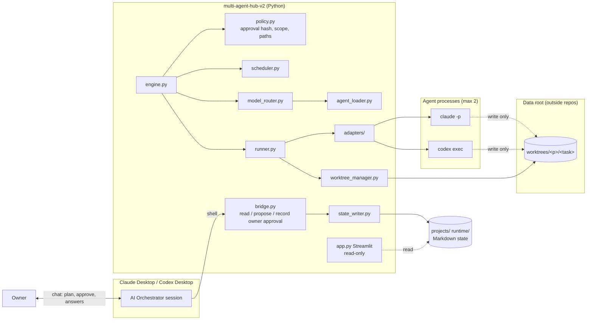
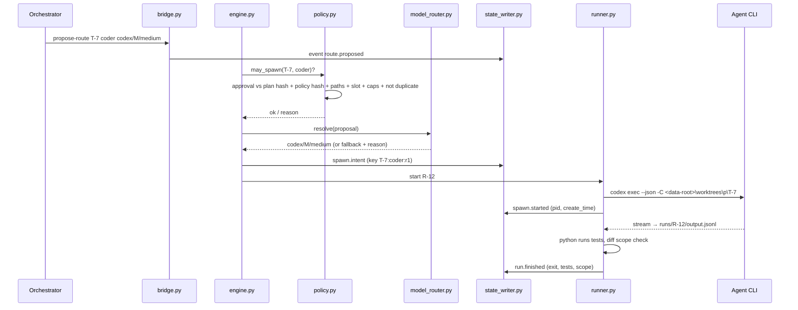
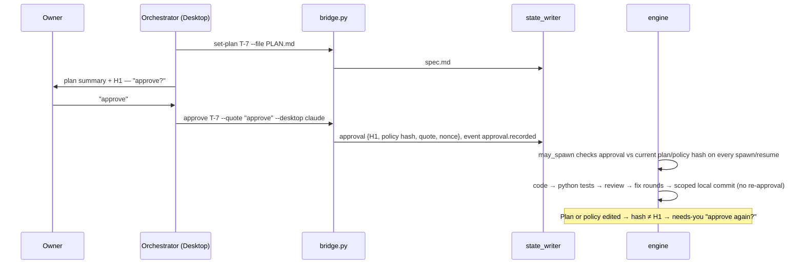
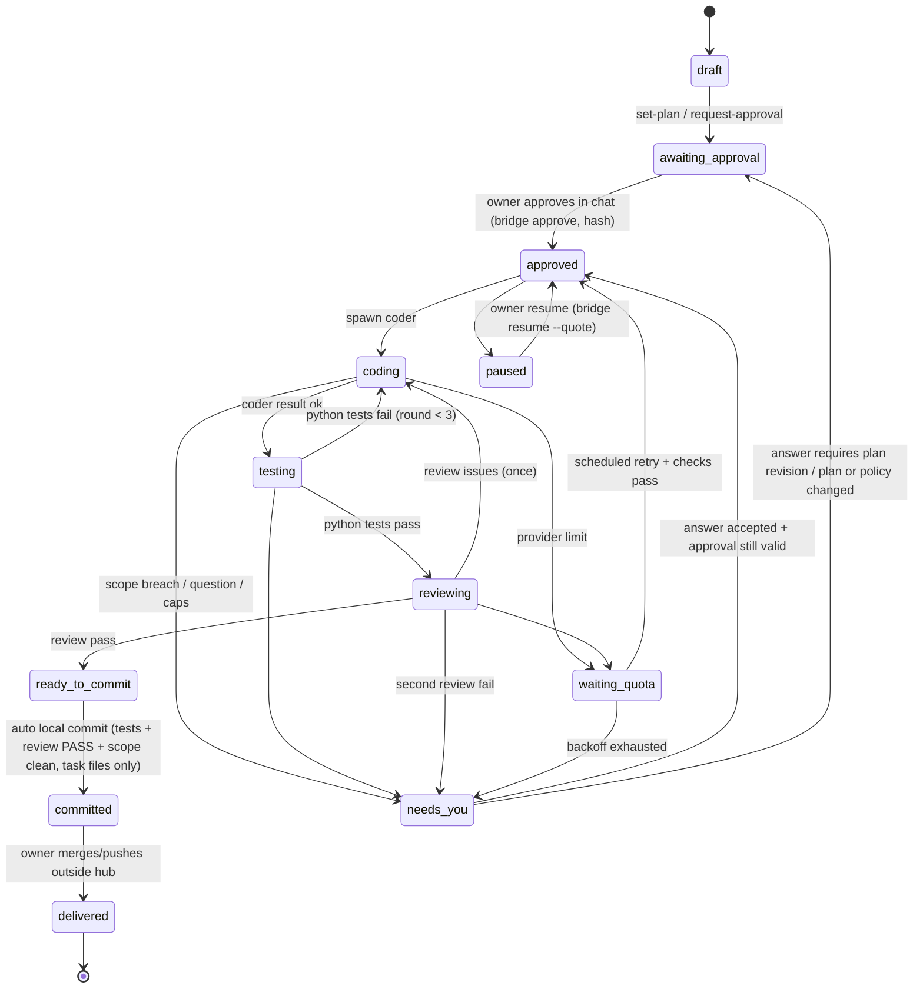
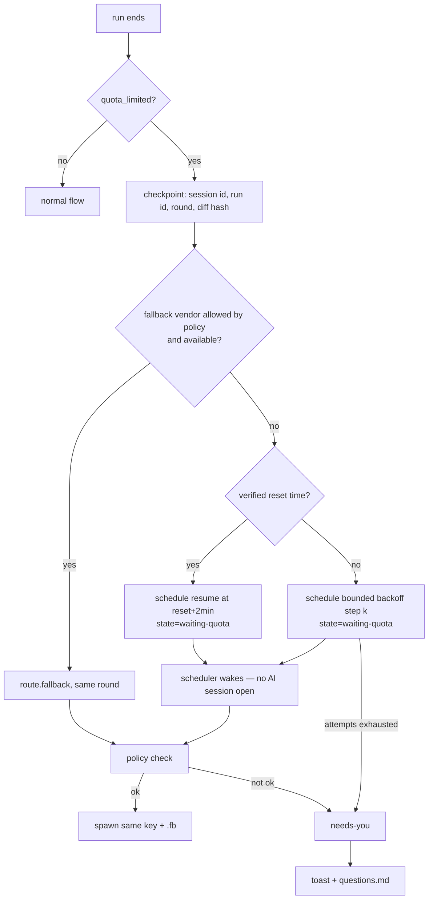
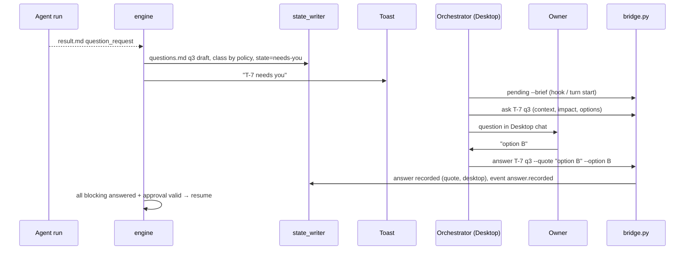

# Multi-Agent Hub v2 — Architecture

Status: **REVISION 3 — conversational owner approval (signing removed, 2026-11-10).** Phase 1 PENDING LIVE VERIFICATION; Security Gate NOT PASS.
Date: 2026-11-09 · Author: Claude Code (orchestrator, planning) · Sibling of v1 `../multi-agent-hub` (v1 untouched)
Revision 2 applies the owner decision "CONDITIONAL APPROVAL — REVISE PLAN BEFORE CODING" (2026-11-09). Change log: §15.

Legend:
- **VERIFIED** = checked on this machine on 2026-11-09 with read-only commands (no agent run, no quota used).
- **PENDING VERIFICATION** = design assumption; must be proven by a Phase-1 test before it may be reported as PASS.
- **NOT PASS (by design)** = a control that cannot be proven under the current setup; must never be reported as passing.

---

## 1. Goals and non-goals

Goals
- Desktop-first: the owner talks to an AI orchestrator in **Claude Desktop (Code tab)** or **Codex Desktop**.
- Markdown-first: all durable task state is human-readable Markdown.
- Python-managed: a Python engine is the only thing that spawns, tracks, retries and stops agent processes.
- Vendor-neutral roles: one set of `agents/*.md` templates used by both Claude Code CLI and Codex CLI.

Non-goals (v2)
- No Node.js, no SQLite, no database server.
- No web chat and no owner inbox in Streamlit (Streamlit = Status, Agent Tree, Timeline, Logs; read-only).
- No push, merge, deploy or cleanup by the hub (owner-only). No git remote on v2.
- No migration of v1 data or runtime. v1 keeps running unchanged.

## 2. Environment facts

| Item | Finding | Status |
|---|---|---|
| v2 path | `C:\Users\Natthawut.j\Desktop\ALI\multi-agent-hub-v2`, was empty and not inside any repo | VERIFIED |
| v2 git | `git init` done (local only, **no remote**), `.gitignore` covers secrets, `.venv`, runtime state, logs, worktrees; nothing committed | VERIFIED |
| v1 repo | `ALI\multi-agent-hub`, `main` @ `75f4561`, 19 pending paths (8 modified, 11 untracked entries), 2 extra worktrees | VERIFIED, unchanged |
| v1 processes | many `node`, `claude`, `codex` processes | v2 never signals processes it did not start |
| Claude Code CLI | `2.1.312`, logged in (claude.ai) | VERIFIED |
| Codex CLI | `codex-cli 0.167.0`, npm shim, logged in (ChatGPT, plan `plus`) | VERIFIED |
| Desktops | Claude `4.23118.0.0`, Codex `26.1103.3517.0` (Appx) | VERIFIED installed |
| Python | `python` on PATH = Microsoft Store stub; real **3.11.3** via `py -3.11`; project `.venv` created | VERIFIED |
| Dependencies (in `.venv` only) | streamlit 1.67.0, PyYAML 6.0.3, psutil 7.2.2, pytest 9.2.0; `pip check` clean; 41 pinned packages in `requirements.lock` | VERIFIED |
| `hashlib.scrypt` | available in stdlib | VERIFIED |
| `cryptography` | installed under R1 (2026-11-09), **no longer used** after Rev 3; removed from requirements, left in `.venv` | — |
| Codex quota data | `~/.codex/sessions/**/*.jsonl` contain `rate_limits.primary/secondary.{used_percent, window_minutes, resets_at(epoch)}` and `rate_limit_reached_type` | VERIFIED (field exists; behaviour at limit PENDING) |
| Claude quota data | no reset-time field found in local session logs | Claude uses bounded backoff unless a stream field is proven |

CLI flags found in `--help` (behaviour PENDING VERIFICATION): Claude `-p`, `--output-format stream-json`, `--model`,
`--effort`, `--resume`, `--session-id`, `--permission-mode`, `--allowedTools`/`--disallowedTools`, `--add-dir`,
`--agents`, `--append-system-prompt-file`, `--json-schema`, `--max-budget-usd`, `--settings`,
`--no-session-persistence`, `claude auth status`. Codex `exec` with `-m`, `-c key=value`, `-s/--sandbox`, `-C/--cd`,
`--json`, `-o`, `--output-schema`, `--ephemeral`, `exec resume`, `login status`, `doctor`, `queue`.

## 3. Architecture decisions (ADR summary)

| # | Decision | Reason |
|---|---|---|
| AD-01 | Python 3.11 stdlib-first; deps `streamlit`, `PyYAML`, `psutil`, `pytest` | Small, auditable |
| AD-02 | Markdown is the source of truth; each file has a fenced machine block + human prose | Owner-readable, strict parsing |
| AD-03 | One writer module + one writer lock; transaction = append event → atomic state replace | Concurrency safety, crash recovery |
| AD-04 | Roles never pin vendor/model/effort; orchestrator proposes, Python decides under `policy.toml` | Directive |
| AD-05 | Python adapters per CLI with one interface | Cross-vendor spawn from one template |
| AD-06 | Desktop Hub Bridge = `bridge.py` JSON CLI, **no authority commands** | Orchestrator and agents can read/propose, never approve |
| AD-07 | **Conversational owner approval** recorded by the orchestrator via `bridge.py approve` with the owner's exact words (Rev 3) | Usability first; workflow control, not identity proof (§6) |
| AD-08 | One git worktree per task, under an **external data root outside every git repo** | Separates runtime data from source; agents' write root never contains hub code |
| AD-09 | Tests are run by Python, not reported by an agent | Trusted test results |
| AD-10 | Scheduler is pure Python; quota wake-ups need no AI session | No idle AI cost |
| AD-11 | Approvals are bound to `sha256(config/policy.toml)`; a policy edit invalidates them | Policy changes always come back to the owner |

## 4. Project structure and path policy

```
multi-agent-hub-v2/                 # git repo (local only) = SOURCE
├── agents/                         # role templates (*.md, YAML frontmatter, vendor-neutral)
├── config/
│   ├── policy.toml                 # concurrency, routing, fallback, retry/backoff caps, scope artifacts
│   └── models.toml                 # model catalog + effort compatibility
├── docs/                           # ARCHITECTURE.md, PHASE-1-PLAN.md, WORKLOG.md, VERIFICATION.md
├── adapters/                       # base.py, claude_cli.py, codex_cli.py
├── tests/
├── app.py  bridge.py  approvals.py  hashing.py  policy.py  engine.py  runner.py  scheduler.py
├── agent_loader.py  model_router.py  state_writer.py  worktree_manager.py  notify.py
├── requirements.txt  requirements.lock  .gitignore
├── projects/  -> gitignored (task Markdown state, see below)
└── runtime/   -> gitignored (locks, engine heartbeat, schedule)

C:\Users\Natthawut.j\Desktop\ALI\multi-agent-hub-v2-data\    # DATA ROOT (created by owner 2026-11-10)
└── worktrees\<project>\<task>\     # one git worktree per task (branch hub/<task>)
```
Leftovers from the removed signing design (`%USERPROFILE%\.mah-v2-owner\`, `config/owner.pub*`, `config/policy.toml.sig`)
are ignored by the code, gitignored, and not deleted automatically.

Task state per task (gitignored, inside v2): `projects/<project>/tasks/<task>/{spec.md, state.md, events.md, questions.md, runs/<run-id>/}`.
Global: `runtime/schedule.md`, `runtime/engine.md`, `runtime/locks/`.

Approved structure changes (owner decision Q5): `adapters/`, `bridge.py`, `policy.py`, `questions.md`, TOML config.
Rev 2 added an external data root (kept). Rev 3 removed the owner console and key/signature files and added `approvals.py`, `hashing.py`.

### 4.1 Path policy (enforced by `policy.py`, tested in Phase 1)
| Rule | Check |
|---|---|
| P1 Data root is outside every git repo | `git -C <root> rev-parse` must fail for the data root and each parent up to the drive |
| P2 Data root is not inside v1, v2, or any registered target repo | resolved absolute path prefix checks (case-insensitive, after `os.path.realpath`) |
| P3 Worktree path = `<data_root>\worktrees\<project>\<task>` only | regex on IDs `[A-Za-z0-9-]{1,32}`; no `..`, no junctions/symlinks (`os.path.realpath` equals the joined path) |
| P4 Target repo must be registered in `projects/<p>/project.md` and must not be v1 or v2 | deny-list `..\multi-agent-hub`, v2 root |
| P5 Path length | full worktree path ≤ 200 chars (Windows MAX_PATH margin); refuse otherwise |
| P6 Worker write roots | the task worktree and its run folder in the data root only; never v2 source, `config/`, `projects/`, `runtime/` |
| P7 Avoid `ALI\worktrees` | existing folder of unknown owner; never used |
| P8 Hub never deletes a worktree | owner-only cleanup |

## 5. Component view



## 6. Approval model and threat model (Rev 3 — conversational approval)

Rev 3 applies the owner decisions "Simplify — remove cryptographic owner signing" and "USABILITY FIRST" (2026-11-10)
and `docs/PLAN-REMOVE-SIGNING.md` Rev 2. Passphrase, keys, Ed25519 signatures, signed policy/manifest and the separate
owner console are **removed**. Leftover key/signature files on disk are ignored by the code and not deleted.

> **Conversational approval is a workflow control, not proof of owner identity and not an isolated security boundary.**
> It records the owner's words from the Desktop conversation. The Desktop orchestrator could record an approval the
> owner never gave; this is visible in the audit trail but not technically prevented. **Security Gate: NOT PASS.**

### 6.1 Actors
| Actor | Trust | Can do |
|---|---|---|
| Owner | trusted | gives instructions and approvals in Claude/Codex Desktop |
| Orchestrator (Desktop AI) | trusted to relay faithfully (workflow), can be wrong or prompt-injected | plans, asks, runs `bridge.py`, records the owner's exact words |
| Worker agent (CLI spawned by hub) | **untrusted** | works inside its worktree; output is data |

### 6.2 Approval records
`bridge.py approve | answer | approve-scope | pause | resume | cancel` write plain records
`{kind, project, task, plan_hash, policy_hash, quote, desktop, recorded_by: "orchestrator", at, nonce}` into task state
and `events.md`. One `approve-plan` covers every spawn, test/fix round, review, quota retry, resume and the scoped local
commit **for that plan hash**. The owner is asked again only when the plan or policy changes, scope must widen, a limit
is exceeded, a failure is unresolved, or an owner-decision question arises.

### 6.3 Threats and controls
| ID | Threat | Control | Result |
|---|---|---|---|
| T1 | Worker output / `result.md` / questions contain "APPROVED" | engine never parses agent text for approval; only bridge records count | **blocked** |
| T2 | Worker records an approval via `bridge.py` | bridge refuses with `HUB_WORKER`/`HUB_RUN_TOKEN` set or cwd in data root (deterrence); Claude workers have no shell (R3); Codex sandbox cannot write `projects/` | **blocked in practice**; Codex part PENDING LIVE-B |
| T4 | Stale approval reused after plan/policy change, or copied to another task | approval bound to plan hash + `sha256(policy.toml)` + project/task; nonce reuse rejected | **blocked** |
| T9 | Worker leaves scope | Python diff check after every run (explicit ignored-artifact allowlist only); breach → needs-you | **blocked** for committed output |
| T11 | Orchestrator records an approval the owner did not give | orchestrator rules (AGENTS.md/CLAUDE.md); exact quote + desktop in audit trail; Streamlit timeline | **not prevented** (accepted) |
| T6 | Tampering with hub code or policy | policy edits invalidate approvals; hub code integrity = git history only | **not enforced at runtime** |
| T7/T10 | Same-user access to memory/credentials | none (same Windows user) | residual risk |

### 6.4 Question classes
`owner-decision` (never auto-answered; blocking until the owner answers through the orchestrator) and `clarify`
(non-blocking ones may use their default). The class comes from `policy.question_class(type)`, never from the caller.

### 6.5 Future isolation (R2, later phase)
Real prevention of T2/T6/T11 needs workers under a separate low-privilege Windows user with NTFS ACLs. Not in Phase 1.

## 7. Agent templates and routing

### 7.1 Template format (`agents/<role>.md`)
```markdown
---
role: coder
description: Implements one approved plan slice inside the task worktree.
capabilities: [read, edit]           # mapped per vendor by the adapter; no shell for Claude workers
writes: worktree                     # none | worktree
inputs: [spec.md#approved-plan, questions.md]
output: result.md
output_schema: schemas/coder.json
max_turns_hint: 40
---
# Instructions
...vendor-neutral prompt body...
```
Keys `vendor`, `model`, `effort` are rejected by `agent_loader.py`. Roles: `planner`, `coder`, `tester`, `reviewer`, `doc-keeper`.
Templates are read by the hub and passed to the CLIs; neither CLI needs to discover them itself.

### 7.2 Rendering per vendor (adapter)
| Need | Claude Code CLI | Codex CLI |
|---|---|---|
| Non-interactive | `claude -p --output-format stream-json` | `codex exec --json` |
| Instructions | `--append-system-prompt-file <run>/prompt.md` | prompt on stdin from `<run>/prompt.md` |
| Model / effort | `--model M --effort E` | `-m M -c model_reasoning_effort=E` |
| Tools | Owner decision R3: `--allowedTools Read,Glob,Grep` only + `--disallowedTools Bash,PowerShell,Edit,Write,NotebookEdit,Agent,Task,WebFetch,WebSearch`; a Claude coder returns a unified diff that the Python trusted runner scope-checks and applies (`git apply --check` first); tests run by Python | sandbox `workspace-write` (coder) / `read-only` (reviewer); `-c features.multi_agent=false` |
| Write scope | cwd = worktree, `--settings <run>/settings.json` deny rules for paths outside cwd | `-C <worktree>` |
| Result | `--json-schema` | `--output-schema`, `-o <run>/last.md` |
| Resume | `--resume <session-id>` | `codex exec resume <id>` |
| No hidden sub-agents | `--disallowedTools Agent` | multi-agent feature off (key PENDING) |
| Spend cap | `--max-budget-usd` | n/a (round + time caps) |

### 7.3 Routing (proposal → decision)
1. Orchestrator: `bridge.py propose-route T-n --role coder --vendor codex --model M --effort medium --reason "..."`.
2. `model_router.py` validates against `config/models.toml` and `policy.toml` (role allowed on vendor, budget).
   Reviewer must differ from coder vendor when both are available; otherwise event `review.same_vendor`.
3. Availability: CLI found, `--version`, `auth status`/`login status`, vendor not in `waiting-quota`.
4. Failure → first allowed fallback in the role's chain; vendor change only if the policy allows it.



### 7.4 Concurrency
`max_processes = 2` for every live hub-started process; dynamic sub-agents (hub-spawned at an agent's request) share
**one** slot inside that ceiling. Agents cannot spawn children outside the hub (T8).

## 8. CLI / Desktop Bridge

`bridge.py` is the orchestrator's entry point; one JSON object per call; refuses in a worker context.

| Command | When | Effect |
|---|---|---|
| `status`, `pending [--brief]`, `show` | any time (auto-allowed in Claude Desktop) | read only |
| `new-task`, `set-plan`, `request-approval`, `propose-route`, `ask` | planning | proposals, questions, events |
| `approve P T --quote "…" --desktop claude\|codex` | right after the owner's explicit approval in chat | records `approve-plan` for the current plan + policy hash |
| `answer P T QID --quote "…" [--option L]` | after the owner answers in chat | records the answer; engine resumes |
| `approve-scope P T --add GLOB --quote "…"` | owner agrees to widen scope | updates plan scope + records approval for the new hash |
| `pause / resume / cancel P T --quote "…"` | owner control | engine obeys |

Questions reach the owner through the orchestrator: Claude Desktop hook (`UserPromptSubmit` → `hooks/pending.py`),
Codex Desktop rule to run `bridge.py pending --brief` each turn, and Windows toast. `codex queue` is not used.
No owner inbox in Streamlit.

## 9. Owner approval flow



## 10. Markdown state machine



File formats: `state.md` = human summary + fenced `hub-state` YAML block (task, status, round, active_run, last_event_seq,
route, worktree); `events.md` = append-only `- 000042 | 2026-11-09T17:40:00+07:00 | spawn.started | T-7 | {json}`;
`schedule.md` = table `| id | due_at | action | task | reason | attempt | max | status |`.

Write protocol (`state_writer.py`): (1) acquire `runtime/locks/writer.lock` via `msvcrt.locking` with timeout;
(2) append event, flush + `os.fsync`; (3) write `state.md.tmp-<pid>`, fsync, `os.replace`, retrying `PermissionError`
(Windows EPERM/EACCES from AV, indexer, Streamlit) with backoff up to 10× / ~3 s; (4) release. Readers never lock and retry.
Crash recovery at engine start: remove stale temp files, replay events newer than `state.md.last_event_seq`;
engine singleton via `runtime/locks/engine.lock`.

## 11. Engine, idempotent spawn and restart

Two-phase spawn with key `task:role:round[:sub]`: `spawn.intent` → process start → `spawn.started {pid, create_time}`.
Restart reconciliation:
| Found | Action |
|---|---|
| PID alive, create_time matches | re-attach; no new spawn |
| intent without start, > 60 s old | `spawn.abandoned`; one re-spawn under the same key (counted) |
| PID gone, result present | finish normally |
| PID gone, no result | `run.lost`; resume via vendor session id if recorded, else `needs-you` |

Caps: 3 coder/tester rounds per task, 1 review-fix cycle, 1 re-spawn per key, quota backoff caps (§12). No unlimited loops.

## 12. Scheduler and quota recovery (owner decision Q4)

Reset time sources, in order — **never guessed**:
1. **Codex:** `rate_limits.primary|secondary.resets_at` (epoch) from the run's `--json` stream or the latest
   `~/.codex/sessions/**/*.jsonl` (field VERIFIED to exist; read without any AI call).
2. **Claude:** a reset field in the `stream-json` error/rate-limit event — PENDING VERIFICATION; none found in local logs.
3. **No verifiable time → bounded backoff** from `policy.toml` (owner-approved R7):

```toml
[quota]
backoff_minutes = [15, 30, 60, 120, 240]   # one resume attempt per step, +0–2 min jitter
max_attempts_per_episode = 5               # then needs-you
max_episodes_per_task_per_day = 3          # then needs-you
verified_reset_grace_minutes = 2           # wake at resets_at + 2 min
```

Each wake: policy check (approval, plan hash, policy hash, scope) → resume (no new owner approval needed) from checkpoint under the same idempotency key.
`scheduler.py` runs inside the engine loop (30 s tick) or standalone `scheduler.py --once`; a Windows Scheduled Task for
`--once` is persistent system config and is created by the owner only if wanted (Decision R4).



## 13. Needs-You protocol

A question must have `title`, `context` (what happened + evidence links), `impact` (what is blocked, cost of each option),
`options` (2–4 with consequences), `default` (or `none`), `blocking`, `class` (`owner-decision` | `clarify`, set by `policy.py`
from the question type), `asked_by`. `bridge.py ask` rejects incomplete questions. Agent-raised questions are drafts; the
orchestrator rewrites them in owner language; both versions are kept.



## 14. Decisions and open items

Owner decisions applied (2026-11-09): Q3 hook + toast yes, `codex queue` no · Q4 verified reset else bounded backoff ·
Q5 structure approved, worktrees outside v2 repo · Q6 local git, no remote (done) · Q7 `.venv` + 4 deps (done, versions §2) ·
Q8 `docs/WORKLOG.md`.
Decided 2026-11-09/10: R1 `cryptography` (later superseded by Rev 3), R2 separate worker user = later phase (design only),
R3 Claude workers read-only, R4 no Scheduled Task in Phase 1, R5 data root approved, R6 superseded by Rev 3,
R7 backoff 15/30/60/120/240. Rev 3: conversational approval replaces signing (owner, 2026-11-10).

## 15. Change log
- Rev 1 (2026-11-09): initial draft.
- Rev 2 (2026-11-09): Desktop permission dialog removed as approval proof; Trusted Approval Channel `owner_console.py`
  with Ed25519; detailed threat model (§6); approval classes `owner-signed`/`relay`; signed policy + source manifest;
  worktrees moved to external data root + path policy (§4.1); Claude workers shell-free; Codex reset field verified;
  bounded backoff; `codex queue` dropped; git init + `.venv` done.
- Rev 3 (2026-11-10): owner "USABILITY FIRST": passphrase, keys, Ed25519 signatures, signed policy/manifest and the owner
  console removed; conversational approval via `bridge.py approve --quote` (workflow control, not identity proof);
  one approval covers the whole plan incl. fix rounds, quota retries and scoped auto local commit; question classes
  `owner-decision`/`clarify`; threat T11 accepted and documented (§6). Plan: `docs/PLAN-REMOVE-SIGNING.md` Rev 2.
