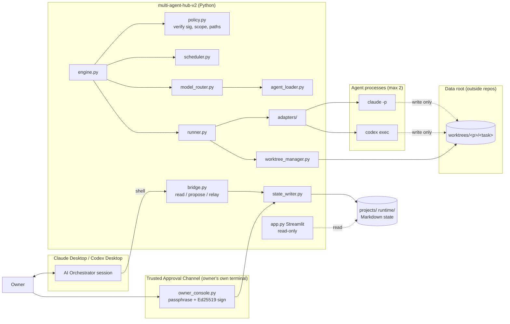
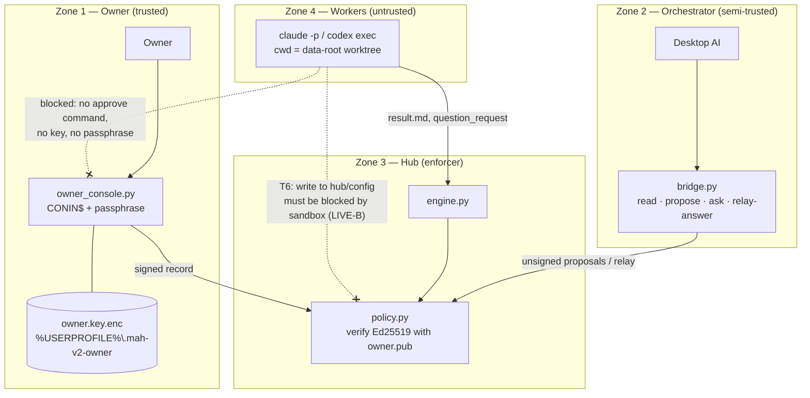
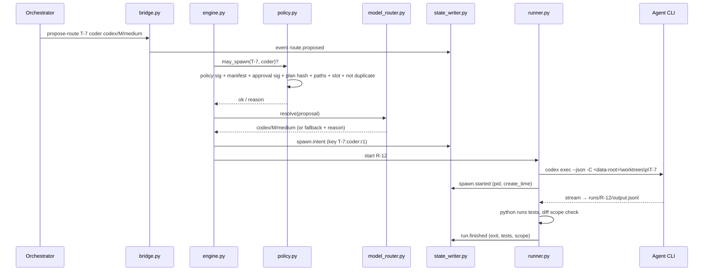
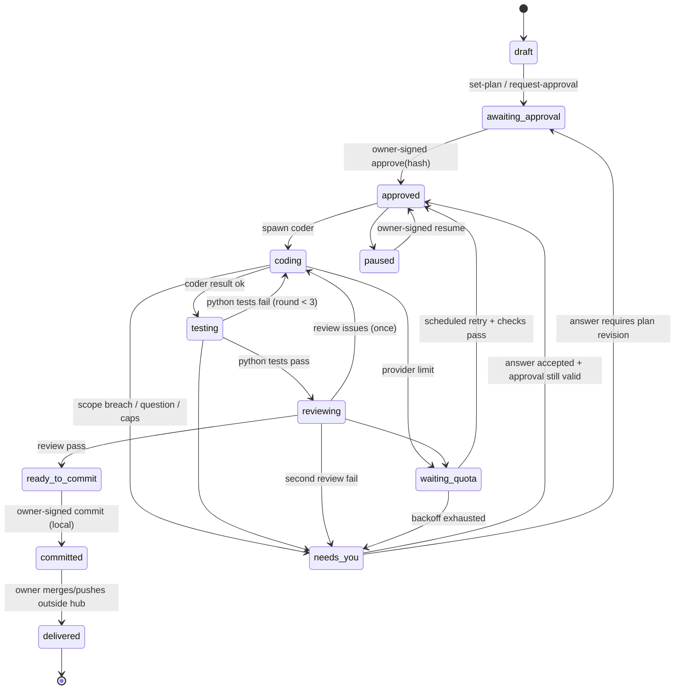
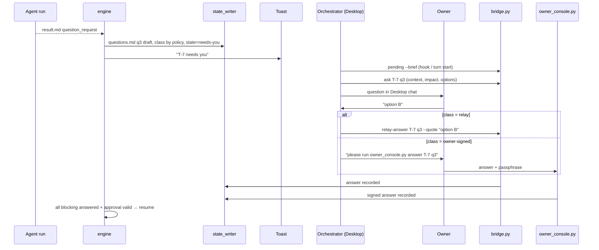

# Multi-Agent Hub v2 — Architecture

Status: **REVISION 2 — awaiting owner Final Coding approval** (planning only, no runtime code exists yet)
Date: 2026-11-09 · Author: Claude Code (orchestrator, planning) · Sibling of v1 `../multi-agent-hub` (v1 untouched)
Revision 2 applies the owner decision "CONDITIONAL APPROVAL — REVISE PLAN BEFORE CODING" (2026-11-09). Change log: §15.

Legend:
- **VERIFIED** = checked on this machine on 2026-11-09 with read-only commands (no agent run, no quota used).
- **PENDING VERIFICATION** = design assumption; must be proven by a Phase-1 test before it may be reported as PASS.
- **NOT PASS (by design)** = a control that cannot be proven under the current setup; must never be reported as passing.

---

## 1. Goals and non-goals

Goals
- Desktop-first: the owner talks to an AI orchestrator in **Claude Desktop (Code tab)** or **Codex Desktop**.
- Markdown-first: all durable task state is human-readable Markdown.
- Python-managed: a Python engine is the only thing that spawns, tracks, retries and stops agent processes.
- Vendor-neutral roles: one set of `agents/*.md` templates used by both Claude Code CLI and Codex CLI.

Non-goals (v2)
- No Node.js, no SQLite, no database server.
- No web chat and no owner inbox in Streamlit (Streamlit = Status, Agent Tree, Timeline, Logs; read-only).
- No push, merge, deploy or cleanup by the hub (owner-only). No git remote on v2.
- No migration of v1 data or runtime. v1 keeps running unchanged.

## 2. Environment facts

| Item | Finding | Status |
|---|---|---|
| v2 path | `C:\Users\Natthawut.j\Desktop\ALI\multi-agent-hub-v2`, was empty and not inside any repo | VERIFIED |
| v2 git | `git init` done (local only, **no remote**), `.gitignore` covers secrets, `.venv`, runtime state, logs, worktrees; nothing committed | VERIFIED |
| v1 repo | `ALI\multi-agent-hub`, `main` @ `75f4561`, 19 pending paths (8 modified, 11 untracked entries), 2 extra worktrees | VERIFIED, unchanged |
| v1 processes | many `node`, `claude`, `codex` processes | v2 never signals processes it did not start |
| Claude Code CLI | `2.1.312`, logged in (claude.ai) | VERIFIED |
| Codex CLI | `codex-cli 0.167.0`, npm shim, logged in (ChatGPT, plan `plus`) | VERIFIED |
| Desktops | Claude `4.23118.0.0`, Codex `26.1103.3517.0` (Appx) | VERIFIED installed |
| Python | `python` on PATH = Microsoft Store stub; real **3.11.3** via `py -3.11`; project `.venv` created | VERIFIED |
| Dependencies (in `.venv` only) | streamlit 1.67.0, PyYAML 6.0.3, psutil 7.2.2, pytest 9.2.0; `pip check` clean; 41 pinned packages in `requirements.lock` | VERIFIED |
| `hashlib.scrypt` | available in stdlib | VERIFIED |
| `cryptography` (Ed25519) | **not installed, not approved** | Decision R1 |
| Codex quota data | `~/.codex/sessions/**/*.jsonl` contain `rate_limits.primary/secondary.{used_percent, window_minutes, resets_at(epoch)}` and `rate_limit_reached_type` | VERIFIED (field exists; behaviour at limit PENDING) |
| Claude quota data | no reset-time field found in local session logs | Claude uses bounded backoff unless a stream field is proven |

CLI flags found in `--help` (behaviour PENDING VERIFICATION): Claude `-p`, `--output-format stream-json`, `--model`,
`--effort`, `--resume`, `--session-id`, `--permission-mode`, `--allowedTools`/`--disallowedTools`, `--add-dir`,
`--agents`, `--append-system-prompt-file`, `--json-schema`, `--max-budget-usd`, `--settings`,
`--no-session-persistence`, `claude auth status`. Codex `exec` with `-m`, `-c key=value`, `-s/--sandbox`, `-C/--cd`,
`--json`, `-o`, `--output-schema`, `--ephemeral`, `exec resume`, `login status`, `doctor`, `queue`.

## 3. Architecture decisions (ADR summary)

| # | Decision | Reason |
|---|---|---|
| AD-01 | Python 3.11 stdlib-first; deps `streamlit`, `PyYAML`, `psutil`, `pytest` (approved) + `cryptography` (**pending R1**) | Small, auditable; Ed25519 is the only sound way to verify approvals without a secret on disk |
| AD-02 | Markdown is the source of truth; each file has a fenced machine block + human prose | Owner-readable, strict parsing |
| AD-03 | One writer module + one writer lock; transaction = append event → atomic state replace | Concurrency safety, crash recovery |
| AD-04 | Roles never pin vendor/model/effort; orchestrator proposes, Python decides under signed policy | Directive |
| AD-05 | Python adapters per CLI with one interface | Cross-vendor spawn from one template |
| AD-06 | Desktop Hub Bridge = `bridge.py` JSON CLI, **no authority commands** | Orchestrator and agents can read/propose, never approve |
| AD-07 | **Trusted Approval Channel = `owner_console.py`**, run by the owner in their own terminal, passphrase-gated asymmetric signature | Agent text, agent commands and Desktop dialogs cannot produce an approval |
| AD-08 | One git worktree per task, under an **external data root outside every git repo** | Separates runtime data from source; agents' write root never contains hub code |
| AD-09 | Tests are run by Python, not reported by an agent | Trusted test results |
| AD-10 | Scheduler is pure Python; quota wake-ups need no AI session | No idle AI cost |
| AD-11 | Policy (`config/policy.toml`) is valid only with an owner signature | Agents cannot change policy silently |

## 4. Project structure and path policy

```
multi-agent-hub-v2/                 # git repo (local only) = SOURCE
├── agents/                         # role templates (*.md, YAML frontmatter, vendor-neutral)
├── config/
│   ├── policy.toml                 # concurrency, routing, fallback, retry/backoff caps
│   ├── policy.toml.sig             # owner Ed25519 signature over policy.toml
│   ├── models.toml                 # model catalog + effort compatibility
│   └── owner.pub                   # owner public key (trust anchor; fingerprint also kept by owner offline)
├── docs/                           # ARCHITECTURE.md, PHASE-1-PLAN.md, WORKLOG.md, VERIFICATION.md
├── adapters/                       # base.py, claude_cli.py, codex_cli.py
├── tests/
├── app.py  bridge.py  owner_console.py  policy.py  engine.py  runner.py  scheduler.py
├── agent_loader.py  model_router.py  state_writer.py  worktree_manager.py
├── requirements.txt  requirements.lock  .gitignore
├── projects/  -> gitignored (task Markdown state, see below)
└── runtime/   -> gitignored (locks, engine heartbeat, schedule)

C:\Users\Natthawut.j\Desktop\ALI\multi-agent-hub-v2-data\    # DATA ROOT (proposed, not created yet)
└── worktrees\<project>\<task>\     # one git worktree per task (branch hub/<task>)

%USERPROFILE%\.mah-v2-owner\        # OWNER SECRET (proposed, created by owner_console init)
└── owner.key.enc                   # Ed25519 private key encrypted with the owner passphrase (scrypt)
```

Task state per task (gitignored, inside v2): `projects/<project>/tasks/<task>/{spec.md, state.md, events.md, questions.md, runs/<run-id>/}`.
Global: `runtime/schedule.md`, `runtime/engine.md`, `runtime/locks/`.

Approved structure changes (owner decision Q5): `adapters/`, `bridge.py`, `policy.py`, `questions.md`, TOML config.
New in revision 2 (needs approval): `owner_console.py`, `config/owner.pub`, `config/policy.toml.sig`, external data root.

### 4.1 Path policy (enforced by `policy.py`, tested in Phase 1)
| Rule | Check |
|---|---|
| P1 Data root is outside every git repo | `git -C <root> rev-parse` must fail for the data root and each parent up to the drive |
| P2 Data root is not inside v1, v2, or any registered target repo | resolved absolute path prefix checks (case-insensitive, after `os.path.realpath`) |
| P3 Worktree path = `<data_root>\worktrees\<project>\<task>` only | regex on IDs `[A-Za-z0-9-]{1,32}`; no `..`, no junctions/symlinks (`os.path.realpath` equals the joined path) |
| P4 Target repo must be registered in `projects/<p>/project.md` and must not be v1 or v2 | deny-list `..\multi-agent-hub`, v2 root |
| P5 Path length | full worktree path ≤ 200 chars (Windows MAX_PATH margin); refuse otherwise |
| P6 Worker write roots | the task worktree and its run folder in the data root only; never v2 source, `config/`, `projects/`, `runtime/`, owner secret dir |
| P7 Avoid `ALI\worktrees` | existing folder of unknown owner; never used |
| P8 Hub never deletes a worktree | owner-only cleanup |

## 5. Component view



## 6. Threat model and approval trust boundary (Q1/Q2, detailed)

### 6.1 Assets
A1 approval records (plan approval, revision approval, authority answers, commit permission) · A2 `config/policy.toml` ·
A3 owner private key + passphrase · A4 hub source code and `config/owner.pub` · A5 task scope (approved plan, allowed paths) ·
A6 vendor credentials (`~/.claude`, `~/.codex`) · A7 v1 repo and processes.

### 6.2 Actors
| Actor | Trust | Can do |
|---|---|---|
| Owner | trusted | types the passphrase only into `owner_console.py` in a terminal the owner opened |
| Orchestrator (Desktop AI) | semi-trusted (can be prompt-injected) | runs `bridge.py`; reads state; proposes plans/routes; relays owner words for `relay` questions |
| Worker agent (CLI spawned by hub) | **untrusted** | runs inside its worktree with restricted tools; its output is data |
| Other local software, same user | out of scope except where noted | — |

### 6.3 Key fact: same Windows user
Workers, the orchestrator, the engine and the owner all run as `Natthawut.j`. Windows gives every process of the same user
the same file access (incl. DPAPI CurrentUser), and same-user processes can read each other's memory. Therefore:
- **Cryptography can stop forgery of approvals** (the passphrase never touches disk or any agent channel).
- **Cryptography cannot stop tampering with the verifier** (an agent that can write hub source, `owner.pub` or
  `policy.toml` can change what "valid" means). Only OS-level separation or a proven sandbox stops that.

### 6.4 Threats and controls
| ID | Threat | Control | Result under same user |
|---|---|---|---|
| T1 | Agent writes "APPROVED"/answer text in output, `result.md`, `spec.md` or `questions.md` | Engine only accepts Ed25519-signed records; text is never parsed for authority | **Blocked** (unit-testable) |
| T2 | Agent (or orchestrator) calls an approve/answer command | `bridge.py` has **no** approve/authority-answer commands; `owner_console.py` refuses without a real console (`CONIN$`, not piped stdin) and requires the passphrase | **Blocked** without passphrase |
| T3 | Agent reads key material from disk | Private key stored only encrypted (scrypt n=2^17, r=8, p=1 + AES/ChaCha via `cryptography`); passphrase ≥ 16 chars enforced at init; `owner.pub` is public by design | **Blocked** for offline brute force with a strong passphrase |
| T4 | Agent replays an old approval | Signature covers `task, kind, plan_hash, policy_hash, question_id, nonce, issued_at`; nonces recorded in events; approval bound to plan hash | **Blocked** |
| T5 | Orchestrator is prompt-injected and tells owner to approve something else | `owner_console.py` shows the plan hash, plan summary and diff stat **read from disk**, not from chat; owner signs what the console shows | **Mitigated** (owner must read the console) |
| T6 | Agent edits `policy.toml`, `owner.pub`, hub `.py` files, or `projects/` state to weaken checks | (a) worker write root = data-root worktree only (P6); (b) Claude workers run without shell tools (§7.2); (c) Codex `workspace-write` sandbox; (d) engine start + `owner_console` verify a signed **source manifest** (sha256 of every tracked file, `owner.pub` fingerprint, policy hash) and refuse on mismatch; (e) `git status` of v2 must be clean at engine start | **NOT PASS (by design)** until the sandbox-escape test (LIVE-B) proves (a)–(c), because (d)/(e) run code the agent could also edit |
| T7 | Agent reads owner passphrase from console memory | Out of reach only with a separate Windows user | **NOT PASS (by design)** — residual risk |
| T8 | Agent spawns hidden sub-agents or extra processes | Claude `--disallowedTools Agent`; Codex multi-agent off (key PENDING); engine counts process tree via psutil and kills **only its own** children over the cap | Mitigated, PENDING VERIFICATION |
| T9 | Agent leaves scope (files outside the plan) | Python diff check after each run vs. allowed paths; breach → `needs-you`, run result discarded | **Blocked** for committed output (unit-testable) |
| T10 | Agent reads vendor credentials (A6) | Not preventable under same user; credentials are already readable by the CLIs themselves | Residual risk, documented |

### 6.5 Approval classes
| Class | Examples | Accepted from |
|---|---|---|
| `owner-signed` | plan approval, every plan revision, scope expansion, policy change, commit permission, resume after invalidation, any security question | **only** `owner_console.py` (Ed25519 signature) |
| `relay` | choose among options that stay inside the approved plan and scope (naming, which of two listed approaches) | orchestrator via `bridge.py relay-answer`, with the owner's words quoted; unsigned; recorded as `relayed` |

A `relay` answer can never change plan hash, scope, policy or approvals; the engine rejects a relay answer for any
question whose class is `owner-signed`, and the class is fixed by `policy.py` rules (question type), not by the asker.
Consequence: even if an agent forged a relay answer, it gains nothing beyond what the approved plan already allows.

### 6.6 Operating modes
| Mode | When | Security Gate status |
|---|---|---|
| **Manual Trusted Approval (Phase 1 default)** | Until LIVE-B proves worker isolation | Approvals are signed in `owner_console.py`; T1–T5, T9 controlled; **Security Gate reported as NOT PASS** because T6/T7 are open |
| Isolated Workers (future) | Workers run as a separate low-privilege Windows user with NTFS ACLs (deny write to v2 + `config`, deny read of owner secret dir) | Security Gate may be reported PASS only after LIVE-B passes in this mode |

Creating a Windows user and changing ACLs is a system/security change: **the owner performs it**, the hub only documents it (Decision R2).

### 6.7 Trust boundary diagram



## 7. Agent templates and routing

### 7.1 Template format (`agents/<role>.md`)
```markdown
---
role: coder
description: Implements one approved plan slice inside the task worktree.
capabilities: [read, edit]           # mapped per vendor by the adapter; no shell for Claude workers
writes: worktree                     # none | worktree
inputs: [spec.md#approved-plan, questions.md]
output: result.md
output_schema: schemas/coder.json
max_turns_hint: 40
---
# Instructions
...vendor-neutral prompt body...
```
Keys `vendor`, `model`, `effort` are rejected by `agent_loader.py`. Roles: `planner`, `coder`, `tester`, `reviewer`, `doc-keeper`.
Templates are read by the hub and passed to the CLIs; neither CLI needs to discover them itself.

### 7.2 Rendering per vendor (adapter)
| Need | Claude Code CLI | Codex CLI |
|---|---|---|
| Non-interactive | `claude -p --output-format stream-json` | `codex exec --json` |
| Instructions | `--append-system-prompt-file <run>/prompt.md` | prompt on stdin from `<run>/prompt.md` |
| Model / effort | `--model M --effort E` | `-m M -c model_reasoning_effort=E` |
| Tools | Owner decision R3: `--allowedTools Read,Glob,Grep` only + `--disallowedTools Bash,PowerShell,Edit,Write,NotebookEdit,Agent,Task,WebFetch,WebSearch`; a Claude coder returns a unified diff that the Python trusted runner scope-checks and applies (`git apply --check` first); tests run by Python | sandbox `workspace-write` (coder) / `read-only` (reviewer); `-c features.multi_agent=false` |
| Write scope | cwd = worktree, `--settings <run>/settings.json` deny rules for paths outside cwd | `-C <worktree>` |
| Result | `--json-schema` | `--output-schema`, `-o <run>/last.md` |
| Resume | `--resume <session-id>` | `codex exec resume <id>` |
| No hidden sub-agents | `--disallowedTools Agent` | multi-agent feature off (key PENDING) |
| Spend cap | `--max-budget-usd` | n/a (round + time caps) |

### 7.3 Routing (proposal → decision)
1. Orchestrator: `bridge.py propose-route T-n --role coder --vendor codex --model M --effort medium --reason "..."`.
2. `model_router.py` validates against `config/models.toml` and the **signed** `policy.toml` (role allowed on vendor, budget).
   Reviewer must differ from coder vendor when both are available; otherwise event `review.same_vendor`.
3. Availability: CLI found, `--version`, `auth status`/`login status`, vendor not in `waiting-quota`.
4. Failure → first allowed fallback in the role's chain; vendor change only if the signed policy allows it.



### 7.4 Concurrency
`max_processes = 2` for every live hub-started process; dynamic sub-agents (hub-spawned at an agent's request) share
**one** slot inside that ceiling. Agents cannot spawn children outside the hub (T8).

## 8. CLI / Desktop Bridge

`bridge.py` prints one JSON object per call. It has **no approve and no authority-answer command**.

| Command | Caller | Effect |
|---|---|---|
| `status [T-n]`, `pending [--brief]`, `show T-n` | orchestrator | read only |
| `new-task`, `set-plan T-n --file`, `propose-route`, `ask T-n` | orchestrator | writes proposals, questions, events |
| `relay-answer T-n q3 --quote "owner's words"` | orchestrator | only for `relay` questions |
| `request-approval T-n` | orchestrator | marks `awaiting-approval`, prints the exact `owner_console.py` command for the owner |

`owner_console.py` (owner only, own terminal): `init` (create key, ≥16-char passphrase), `approve T-n`, `answer T-n q3`,
`sign-policy`, `sign-manifest`, `commit T-n`, `resume T-n`, `verify`. Each shows what will be signed, read from disk,
and asks for the passphrase via the console.

Questions reach the owner through the orchestrator (owner decision Q3):
- **Claude Desktop:** v2 ships a project hook (`UserPromptSubmit`/`SessionStart`) running `bridge.py pending --brief`
  so open questions appear in the orchestrator's context each turn — approved in principle, PENDING VERIFICATION.
- **Codex Desktop:** v2 `AGENTS.md` tells the orchestrator to run `bridge.py pending --brief` at the start of each turn.
- **Windows notification:** toast via PowerShell `Windows.UI.Notifications` (no module) when a question opens — approved in principle.
- `codex queue`: **not used** until a separate measured test is approved (owner decision Q3).
- No owner inbox in Streamlit. If no Desktop session is open, questions wait in `questions.md`.

## 9. Owner approval flow

```mermaid
sequenceDiagram
  participant O as Owner
  participant ORC as Orchestrator (Desktop)
  participant BR as bridge.py
  participant OC as owner_console.py (owner terminal)
  participant SW as state_writer
  participant ENG as engine
  ORC->>BR: set-plan T-7 --file PLAN.md
  BR->>SW: spec.md ## Proposed Plan (hash H1), state=awaiting-approval
  ORC->>BR: request-approval T-7
  BR-->>ORC: "run: owner_console.py approve T-7"
  ORC->>O: plan summary + H1 + command to run
  O->>OC: approve T-7 (own terminal)
  OC->>OC: verify manifest + policy sig; show plan from disk + H1
  O->>OC: passphrase (CONIN$)
  OC->>SW: spec.md ## Approval {H1, policy hash, nonce, sig}
  ENG->>ENG: verify sig with owner.pub before every spawn/resume
  Note over ENG: Plan edited → hash ≠ H1 → awaiting-approval (revision needs a new signature)
```

## 10. Markdown state machine



File formats: `state.md` = human summary + fenced `hub-state` YAML block (task, status, round, active_run, last_event_seq,
route, worktree); `events.md` = append-only `- 000042 | 2026-11-09T17:40:00+07:00 | spawn.started | T-7 | {json}`;
`schedule.md` = table `| id | due_at | action | task | reason | attempt | max | status |`.

Write protocol (`state_writer.py`): (1) acquire `runtime/locks/writer.lock` via `msvcrt.locking` with timeout;
(2) append event, flush + `os.fsync`; (3) write `state.md.tmp-<pid>`, fsync, `os.replace`, retrying `PermissionError`
(Windows EPERM/EACCES from AV, indexer, Streamlit) with backoff up to 10× / ~3 s; (4) release. Readers never lock and retry.
Crash recovery at engine start: remove stale temp files, replay events newer than `state.md.last_event_seq`;
engine singleton via `runtime/locks/engine.lock`.

## 11. Engine, idempotent spawn and restart

Two-phase spawn with key `task:role:round[:sub]`: `spawn.intent` → process start → `spawn.started {pid, create_time}`.
Restart reconciliation:
| Found | Action |
|---|---|
| PID alive, create_time matches | re-attach; no new spawn |
| intent without start, > 60 s old | `spawn.abandoned`; one re-spawn under the same key (counted) |
| PID gone, result present | finish normally |
| PID gone, no result | `run.lost`; resume via vendor session id if recorded, else `needs-you` |

Caps: 3 coder/tester rounds per task, 1 review-fix cycle, 1 re-spawn per key, quota backoff caps (§12). No unlimited loops.

## 12. Scheduler and quota recovery (owner decision Q4)

Reset time sources, in order — **never guessed**:
1. **Codex:** `rate_limits.primary|secondary.resets_at` (epoch) from the run's `--json` stream or the latest
   `~/.codex/sessions/**/*.jsonl` (field VERIFIED to exist; read without any AI call).
2. **Claude:** a reset field in the `stream-json` error/rate-limit event — PENDING VERIFICATION; none found in local logs.
3. **No verifiable time → bounded backoff** from the signed policy (proposed defaults, owner to confirm):

```toml
[quota]
backoff_minutes = [15, 30, 60, 120, 240]   # one resume attempt per step, +0–2 min jitter
max_attempts_per_episode = 5               # then needs-you
max_episodes_per_task_per_day = 3          # then needs-you
verified_reset_grace_minutes = 2           # wake at resets_at + 2 min
```

Each wake: policy check (approval, plan hash, scope, policy sig) → resume from checkpoint under the same idempotency key.
`scheduler.py` runs inside the engine loop (30 s tick) or standalone `scheduler.py --once`; a Windows Scheduled Task for
`--once` is persistent system config and is created by the owner only if wanted (Decision R4).


## 13. Needs-You protocol

A question must have `title`, `context` (what happened + evidence links), `impact` (what is blocked, cost of each option),
`options` (2–4 with consequences), `default` (or `none`), `blocking`, `class` (`owner-signed` | `relay`, set by `policy.py`
from the question type), `asked_by`. `bridge.py ask` rejects incomplete questions. Agent-raised questions are drafts; the
orchestrator rewrites them in owner language; both versions are kept.



## 14. Decisions and open items

Owner decisions applied (2026-11-09): Q3 hook + toast yes, `codex queue` no · Q4 verified reset else bounded backoff ·
Q5 structure approved, worktrees outside v2 repo · Q6 local git, no remote (done) · Q7 `.venv` + 4 deps (done, versions §2) ·
Q8 `docs/WORKLOG.md` · Q1/Q2 Desktop dialog rejected as identity proof → §6.

Open for owner decision:
| ID | Question | Options | Recommendation |
|---|---|---|---|
| R1 | Add `cryptography` (Ed25519 + key encryption) to `.venv` | A) approve; B) HMAC with secret on disk (forgeable by any same-user agent → rejected); C) pure-Python Ed25519 (unaudited) | **A** — without it, T1–T4 cannot be blocked |
| R2 | Separate low-privilege Windows user for workers (needed for Security Gate PASS) | A) later phase, owner sets up user + ACLs; B) never (gate stays NOT PASS) | **A**, after Phase 1 |
| R3 | Claude workers without shell tools | A) yes (tests run by Python); B) allow Bash (cannot be path-restricted on Windows → T6 wider) | **A** |
| R4 | Standalone scheduler via Windows Scheduled Task | A) engine loop only in Phase 1; B) owner creates the task | **A** |
| R5 | Data root path | `C:\Users\Natthawut.j\Desktop\ALI\multi-agent-hub-v2-data` | approve or give another path |
| R6 | Owner secret path | `%USERPROFILE%\.mah-v2-owner\` | approve or give another path |
| R7 | Bounded backoff numbers (§12) | accept defaults or edit | accept |

## 15. Change log
- Rev 1 (2026-11-09): initial draft.
- Rev 2 (2026-11-09): Desktop permission dialog removed as approval proof; Trusted Approval Channel `owner_console.py`
  with Ed25519; detailed threat model (§6); approval classes `owner-signed`/`relay`; signed policy + source manifest;
  worktrees moved to external data root + path policy (§4.1); Claude workers shell-free; Codex reset field verified;
  bounded backoff; `codex queue` dropped; git init + `.venv` done.
