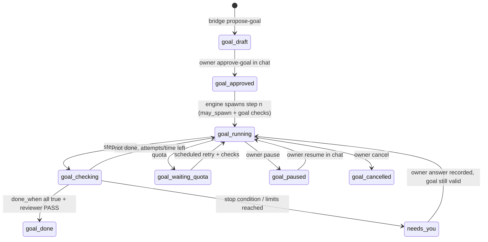

# Phase 2 Blueprint — Goal-Driven Execution

Status: **DRAFT — planning only** (owner decision "Goal-Driven Execution: DEFER IMPLEMENTATION TO PHASE 2", 2026-11-10).
No Phase 1 runtime file changes. No goal runtime code until the owner approves the Phase 2 Implementation Plan.
Phase 1 remains **PENDING LIVE VERIFICATION**; Security Gate **NOT PASS**.

## 1. Order of work
1. Phase 1 baseline commit (local) → LIVE-A … LIVE-E, each separately approved.
2. Compatibility spike for `/goal` (Codex Desktop + Codex CLI) — needs its own approval (uses quota).
3. Goal Contract design (this document §3) → Phase 2 Implementation Plan (Files/Acceptance/Stop) → owner approval → coding.

## 2. What is known today (read-only checks, 2026-11-10)
| Item | Finding | Status |
|---|---|---|
| Codex feature flag `goals` | listed by `codex features list` as `stable`, enabled | VERIFIED (flag exists) |
| `/goal` in Codex CLI `exec` | no `goal` option in `codex --help` / `codex exec --help`; unknown whether `/goal` text in a non-interactive prompt is honoured | **PENDING — spike S1** |
| `/goal` in Codex Desktop | not inspected | **PENDING — spike S2** |
| Claude Code goal mode | no `goal` option in `claude --help` | Treated as **not available**; Claude runs stay plain hub-driven runs |
| Goal state location / resume semantics | unknown (session file? thread metadata?) | **PENDING — spike S1/S3** |

## 3. Goal Contract (design)
A goal is never a free-running agent. It is a Markdown contract bound to an approved spec, executed as a sequence of
ordinary hub runs that Python spawns, pauses, resumes and cancels.

`projects/<p>/tasks/<t>/goal.md` (machine block ` ```hub-goal ` YAML + human text):
| Field | Meaning | Enforced by |
|---|---|---|
| `goal_id`, `project`, `task` | identity | policy.py |
| `objective` | one-paragraph outcome, taken from the approved plan | owner approval in chat |
| `spec_plan_hash` | must equal the current approved `plan_hash` | policy.may_spawn (every step) |
| `policy_hash` | `sha256(policy.toml)` at approval time | policy.may_spawn |
| `allowed_paths` | ⊆ project `allowed_paths`; never wider | policy.check_scope after every step |
| `done_when` | list of machine-checkable conditions (python test command exit 0, files exist, reviewer PASS) | runner (trusted), never agent text |
| `time_limit_minutes` | active run time cap (same accounting as Phase 1 team cap) | engine |
| `attempt_limit` | max goal steps (runs) | engine |
| `quota_policy` | reuse Phase 1 bounded backoff | scheduler |
| `stop_conditions` | scope violation, security boundary, repeated identical failure ×2, reviewer FAIL ×2, unknown CLI behaviour | engine → needs-you |
| `vendor_mode` | `codex-goal` (only if spike S1 passes) or `stepwise` (hub loop, any vendor) | model_router |
| `approval` | conversational record kind **`approve-goal`** (owner's exact words, goal hash) via `bridge.py approve-goal` | orchestrator after the owner's explicit approval in chat (workflow control, ARCHITECTURE Rev 3 §6) |

Rules:
- Goal approval is a separate conversational owner record (`approve-goal`, exact quote); it never extends plan approval, and any plan revision invalidates it.
- An agent cannot create, widen or extend a goal; `bridge.py` can only *propose* a goal draft.
- "Done" is decided by Python from `done_when` checks plus a reviewer PASS, never by the agent saying so.
- Each goal step is a normal run with an idempotency key `task:goal:<goal_id>:<n>`; restart rules of Phase 1 §11 apply.

## 4. Python control (spawn / pause / resume / cancel)
| Action | Who | Mechanism |
|---|---|---|
| spawn step n | engine | `may_spawn` + goal checks (hash, limits, scope) → runner.start |
| pause | owner in chat (`bridge.py pause --quote`) or engine stop condition | state `goal-paused`; no new step; live step allowed to finish or is stopped via `runner.stop` (own PID only) |
| resume | owner in chat (`bridge.py resume --quote`) | re-verify goal + plan + policy before next step |
| cancel | owner in chat (`bridge.py cancel --quote`) | stop live step, state `goal-cancelled`, worktree kept (owner-only cleanup) |
| quota | scheduler | Phase 1 bounded backoff; goal time limit counts active time only |

If `vendor_mode = codex-goal`, the hub still runs Codex one bounded step at a time (per-step time/attempt caps,
`-c features.multi_agent=false`), checks scope and tests between steps, and can stop the process. If spike S1 shows the
goal mode cannot be bounded or observed from Python, `codex-goal` is not used and `stepwise` is the only mode.



## 5. Compatibility spike (needs separate approval; small quota)
| ID | Question | Method | Pass criteria |
|---|---|---|---|
| S1 | Does `codex exec` honour `/goal` (or a goal config) non-interactively, and can Python bound and stop it? | throwaway repo in the data root; one tiny goal; `--json` stream recorded | goal start/finish visible in JSON events; process exits on its own within a cap; `runner.stop` stops it; no writes outside worktree |
| S2 | Codex Desktop `/goal` — can the hub observe or hand off a goal started there? | owner starts a trivial goal in Desktop; hub reads only | documented yes/no; hub never controls a Desktop goal it did not spawn |
| S3 | Where is goal state stored and can it resume after kill? | inspect `~/.codex/sessions` after S1 (read-only) | resume via `exec resume` honours the same goal, or documented "no" |
STOP (owner rule): if goal mode does not work in the CLI, or any spike shows a path around approval/security boundaries,
Phase 2 uses `stepwise` mode only and the finding is reported.

## 6. Phase 2 Implementation Plan (to be written after the spikes)
Expected file scope (estimate, not approved): `goal.py` (new; contract load/validate), additions to `policy.py`
(goal checks), `engine.py` (goal loop), `approvals.py` (`approve-goal` kind), `bridge.py`
(`propose-goal`, `goal-status`), `adapters/codex_cli.py` (`codex-goal` mode only if S1 passes), tests
`tests/test_goal_contract.py`, `tests/test_goal_engine.py`. Acceptance and stop conditions will mirror §3–§5.

## 7. Open questions for the owner
| ID | Question | Recommendation |
|---|---|---|
| G1 | Approve spike S1/S3 after LIVE-A passes? | yes, as one small LIVE-style step |
| G2 | Default `vendor_mode` | `stepwise` until S1 passes |
| G3 | Default limits | `time_limit_minutes = 60`, `attempt_limit = 6` |
