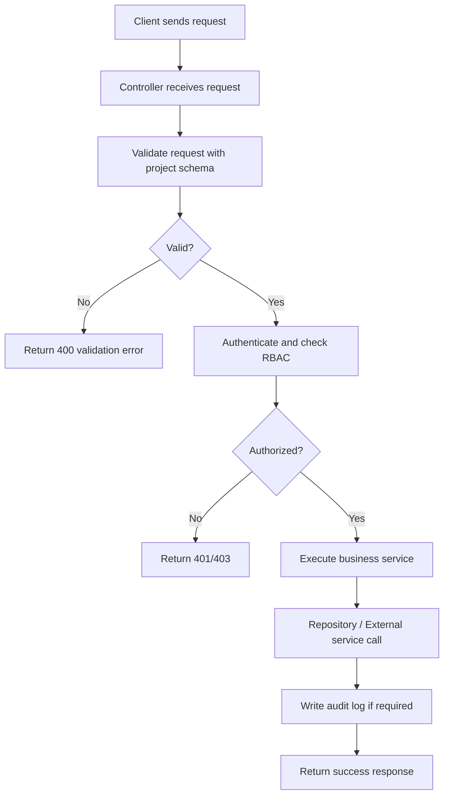
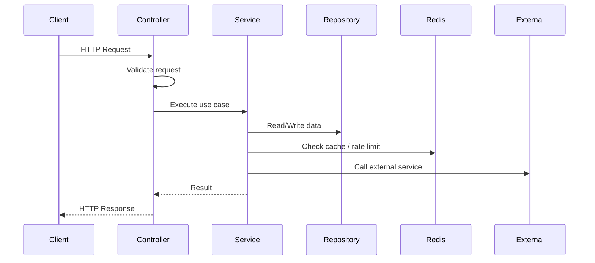
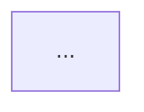

# API Specification and Flow Chart Standard

ก่อนใช้งาน ให้ระบุ business requirements, source repository และแผนงานของ target project ให้ชัดเจน

เอกสารนี้เป็นมาตรฐานกลางสำหรับการจัดทำ API specification และ API flow chart ของทุก backend system ที่ Hub ดูแล

ตัวอย่างชื่อ framework, validator, identity provider, table และ external service ในเอกสารนี้เป็นตัวอย่างเท่านั้น ต้องแทนด้วย technology และ contract จริงของ target project

## Purpose

มาตรฐานนี้ถูกใช้เพื่อให้ทุก endpoint มีรูปแบบเอกสารเหมือนกัน อ่านง่าย ตรวจสอบง่าย และเชื่อมโยงกลับไปยัง business requirement ได้ชัดเจน

ทุก endpoint document ต้องตอบคำถามได้ครบดังนี้

- endpoint นี้ทำอะไร
- ใครเรียกได้
- request/response เป็นอย่างไร
- validate อะไรบ้าง
- มี business rules อะไร
- กระทบ data อะไร
- เรียก external service อะไร
- ต้อง audit log หรือไม่
- error case มีอะไร
- flow การทำงานเป็นอย่างไร

## Source Of Truth

การเขียนเอกสาร endpoint ต้องอ้างอิงข้อมูลจากแหล่งต่อไปนี้ตามลำดับ

1. approved requirements / business module และ acceptance criteria
2. current source, tests และ API/schema contracts
3. architecture summary และ target-project documentation
4. backend solution / implementation plan
5. data dictionary / ER diagram / SQL schema ถ้ามีข้อมูลเชิงโครงสร้างเพิ่มเติม

ถ้าข้อมูลจากหลายแหล่งขัดกัน ให้แยก current behavior ออกจาก desired behavior และใส่ `Open Questions` ไว้ท้ายเอกสาร endpoint หากไม่มีข้อมูลอ้างอิงเดิมหรือไม่สามารถยืนยันได้จาก source ที่มีอยู่ ห้าม assume หรือกำหนดขึ้นเอง

## Scope Per Endpoint Document

เอกสารของ 1 endpoint ต้องครอบคลุม 2 ส่วนหลัก

1. API Specification
2. API Flow Chart

ถ้า endpoint มีหลาย flow ที่ behavior ต่างกันชัดเจน เช่น success, validation fail, async job, external callback ให้แยก flow ย่อยในเอกสารเดียวกัน

## Required Rules

- ใช้ชื่อ endpoint ตาม path จริงของ API เท่านั้น
- method และ path ต้องระบุเต็มเสมอ
- ต้องอ้างอิง business module และ requirement/use case ที่เกี่ยวข้อง
- ต้องระบุ auth mode ให้ชัด เช่น `JWT`, `API Key`, `Public`, `Backoffice Admin`
- ต้องระบุ tenant/data boundary และ scope key ที่ target project ใช้ หากระบบเป็น multi-tenant
- ต้องระบุ validation ให้ map ไปยัง validation framework หรือ schema contract ของ target project ได้
- ต้องระบุ permission/rbac ให้ชัดเจน
- ต้องระบุ side effects เช่น audit log, queue job, quota or balance deduction, Redis write, external API call
- ต้องระบุ error response หลักที่ frontend ต้องรับมือ
- ต้องมี flow chart อย่างน้อย 1 แบบต่อ 1 endpoint

## Recommended File Naming

แนะนำให้ตั้งชื่อไฟล์ตาม pattern นี้

```text
{tag}/{METHOD}_{normalized_path}.md
```

ตัวอย่าง

```text
auth/POST_api_auth_login.md
customers/GET_api_customers.md
orders/POST_api_orders_id_checkout.md
```

## File Structure Options

ทุก endpoint สามารถเลือกจัดเก็บได้ 2 รูปแบบตามความซับซ้อน:

### 1. Unified File (แนะนำสำหรับ endpoint ทั่วไป)
รวบรวมทั้ง Specification และ Flow Chart ไว้ในไฟล์เดียวภายใต้โฟลเดอร์ `api-spec/` (หรือโฟลเดอร์ที่ตกลงกัน) โดยใช้หัวข้อครบทั้ง 1-10

### 2. Split Files (แนะนำสำหรับ endpoint ที่มี business logic หรือ flow ซับซ้อน)
แยกออกเป็น 2 ไฟล์เพื่อให้อ่านง่ายขึ้น:
- **API Specification File**: เก็บไว้ใน `api-spec/` บรรจุหัวข้อ 1-8 และ 10 โดยในหัวข้อ 9 ให้ใส่ลิงก์ไปยังไฟล์ Flow Chart
- **API Flow Chart File**: เก็บไว้ใน `api-flow-chart/` บรรจุหัวข้อ 9 เป็นหลัก

## Standard Structure

ทุก endpoint document ควรใช้โครงสร้างเดียวกันดังนี้

```md
# {METHOD} {PATH}

## 1. Overview
## 2. Business Reference
## 3. Access Control
## 4. Request Specification
## 5. Response Specification
## 6. Business Rules
## 7. Data and Side Effects
## 8. Error Cases
## 9. API Flow Chart
## 10. Open Questions
## 11. Conditions (Step-by-Step)

> [!NOTE]
> กรณีแยกไฟล์ (Split Files):
> - ไฟล์ใน `api-spec/` จะมีหัวข้อ 1-8, 10-11 และหัวข้อ 9 ที่ระบุลิงก์ไปหาไฟล์ Flow Chart
> - ไฟล์ใน `api-flow-chart/` จะต้องเริ่มหัวข้อด้วย `## 9. API Flow Chart` เสมอ เพื่อให้ลำดับตรงกัน
```

## Section Details

### 1. Overview

ต้องอธิบายสั้น ๆ ว่า endpoint นี้ทำอะไร และใช้ในหน้าจอหรือ use case ไหน

ต้องมีอย่างน้อย

- `Summary`
- `Module`
- `Primary Actor`
- `Trigger`
- `Synchronous/Asynchronous`

ตัวอย่าง

```md
## 1. Overview

- Summary: ใช้ checkout order เพื่อเริ่มกระบวนการชำระเงินและจัดส่ง
- Module: Order Management
- Primary Actor: Owner, Admin, User
- Trigger: ผู้ใช้กดปุ่ม Checkout
- Synchronous/Asynchronous: Sync for validation, async for fulfilment
```

### 2. Business Reference

ต้องเชื่อม endpoint กลับไปยัง business docs

ต้องมีอย่างน้อย

- `Business Module`
- `Business File`
- `Functional Requirements`
- `Use Cases`
- `Related Entities`

ตัวอย่าง

```md
## 2. Business Reference

- Business Module: Module {NN} Order Management
- Business File: `docs/business/{NN}_ORDER.md`
- Functional Requirements: stock check, price snapshot, cancel before shipment
- Use Cases: UC-{nn} to UC-{nn}
- Related Entities: Order, OrderItem, Payment, AuditLog
```

### 3. Access Control

ต้องนิยามชัดว่าใครเรียก endpoint ได้ และระบบตรวจสิทธิ์อย่างไร

ต้องมีอย่างน้อย

- `Authentication`
- `Allowed Roles`
- `Scope / Tenant Boundary`
- `Rate Limit`

ตัวอย่าง

```md
## 3. Access Control

- Authentication: JWT Bearer
- Allowed Roles: owner, admin, user
- Scope / Tenant Boundary: ใช้ข้อมูลภายใต้ scope key ของ authenticated context เท่านั้น (ถ้ามี)
- Rate Limit: 10 requests/minute per user
```

### 4. Request Specification

ต้องเขียน request ให้พร้อมแปลงเป็น OpenAPI และ validation schema ของ target project

ต้องมีอย่างน้อย

- `Method`
- `Path`
- `Path Params`
- `Query Params`
- `Headers`
- `Cookies` ถ้ามี
- `Request Body`
- `Validation Rules`
- `Example Request`

รูปแบบที่แนะนำ

```md
## 4. Request Specification

- Method: `POST`
- Path: `/api/auth/login`

### Headers
| Name | Required | Description |
| --- | --- | --- |
| Content-Type | Yes | `application/json` |

### Request Body
| Field | Type | Required | Rules | Description |
| --- | --- | --- | --- | --- |
| email | string | No/Yes by flow | valid email | user email |
| password | string | No/Yes by flow | min 8 | plain password |
| code | string | No/Yes by flow | non-empty | authorization code from identity provider |

### Validation Rules
- ต้องมีอย่างน้อย 1 login mode ที่ valid
- ถ้าใช้ password login ต้องส่ง `email` และ `password`
- ถ้าใช้ SSO callback ต้องส่ง `code`
```

### 5. Response Specification

ต้องระบุ response success และ error ให้ frontend ใช้ต่อได้

ต้องมีอย่างน้อย

- `Success Status`
- `Success Body`
- `Error Statuses`
- `Error Shape`
- `Example Response`

รูปแบบที่แนะนำ

```md
## 5. Response Specification

### Success Response
- Status: `200 OK`

| Field | Type | Nullable | Description |
| --- | --- | --- | --- |
| access_token | string | No | JWT access token |
| refresh_token | string | No | JWT refresh token |
| requires_2fa | boolean | No | ต้องยืนยัน 2FA หรือไม่ |

### Error Response
| Status | Code | Meaning |
| --- | --- | --- |
| 400 | VALIDATION_ERROR | request ไม่ถูกต้อง |
| 401 | INVALID_CREDENTIALS | login ไม่สำเร็จ |
| 403 | PRODUCT_INACTIVE | ไม่มีสิทธิ์ใช้งาน product |
| 429 | TOO_MANY_REQUESTS | เกิน rate limit |
```

### 6. Business Rules

สรุป logic ที่สำคัญจาก business doc โดยไม่ลง implementation detail เกินจำเป็น

ต้องมีอย่างน้อย

- validation rule สำคัญ
- tenant isolation
- permission constraints
- state transition ถ้ามี
- quota / limit / cooldown / TTL ถ้ามี
- external dependency constraints ถ้ามี

ตัวอย่าง

```md
## 6. Business Rules

- Login failure ต้องใช้ generic error message เพื่อป้องกัน email enumeration
- ถ้า user เปิด 2FA ต้องหยุด flow ที่ pre-auth state ก่อน
- ถ้า user มีหลาย organization ต้องให้เลือก org ก่อนใช้งาน
- ทุกการ login attempt ต้องถูกบันทึก audit log
```

### 7. Data and Side Effects

ส่วนนี้บอกให้ชัดว่า endpoint แตะข้อมูลอะไรบ้าง

ต้องมีอย่างน้อย

- `Read Models/Tables`
- `Write Models/Tables`
- `Redis Keys`
- `Queue/Job`
- `External Services`
- `Audit Log`

รูปแบบที่แนะนำ

```md
## 7. Data and Side Effects

- Read Models/Tables: `users`, `user_organizations`
- Write Models/Tables: `user_sessions`, `audit_logs`
- Redis Keys: `login_attempt:{ip}`, `otp:{reference_id}`
- Queue/Job: none
- External Services: identity provider, cache service
- Audit Log: `LOGIN_SUCCESS`, `LOGIN_FAIL`
```

### 8. Error Cases

ต้องแตก error ที่สำคัญในเชิง business และ system

อย่างน้อยควรมี

- validation error
- unauthorized/forbidden
- not found
- conflict
- dependency failure
- domain-specific failure

ตัวอย่าง

```md
## 8. Error Cases

| Scenario | Status | Code | Message |
| --- | --- | --- | --- |
| email format invalid | 400 | VALIDATION_ERROR | Invalid email format |
| wrong password | 401 | INVALID_CREDENTIALS | อีเมลหรือรหัสผ่านไม่ถูกต้อง |
| 2FA expired | 401 | OTP_EXPIRED | OTP expired |
| org not found in scope | 404 | ORGANIZATION_NOT_FOUND | Organization not found |
| identity provider unavailable | 503 | IDP_UNAVAILABLE | Authentication service unavailable |
```

### 9. API Flow Chart

เป็นส่วนบังคับ และต้องใช้ Mermaid เพื่อให้เอกสารทุก endpoint สม่ำเสมอ

ไฟล์ใน `api-flow-chart/` ต้องอธิบายลำดับการทำงานของ endpoint ให้เห็นทั้งมุม business flow และมุม system interaction

### 9.1 Minimum Requirements

ทุกไฟล์ใน `api-flow-chart/` ต้องมีอย่างน้อย

- ชื่อ endpoint ชัดเจนที่หัวไฟล์
- ลิงก์กลับไปยังไฟล์ API specification ที่เกี่ยวข้อง
- `Flowchart` อย่างน้อย 1 ชุด
- `Open Questions` ถ้ายังมีจุดกำกวมจาก business docs หรือ plan

### 9.2 When To Use Each Diagram

#### Flowchart

ใช้เพื่ออธิบาย decision flow ของ endpoint เช่น

- validation
- authorization
- branching logic
- business rules
- success/fail path
- state transition

ทุก endpoint ต้องมี `flowchart` อย่างน้อย 1 อัน

#### Sequence Diagram

ใช้เพื่ออธิบาย interaction ระหว่าง actor หรือ system หลายตัว เช่น

- Client
- Controller
- Service
- Repository / Database
- Redis
- Queue / Worker
- IdentityProvider
- EmailProvider
- NotificationProvider
- Internal service อื่น

ควรเพิ่ม `sequenceDiagram` เมื่อ endpoint มีลักษณะอย่างน้อย 1 ข้อดังนี้

- มี external service call
- มี cache / Redis interaction
- มี queue หรือ async dispatch
- มีหลายชั้นของระบบที่สำคัญต่อการเข้าใจ flow
- มีหลาย participant ที่ frontend/backend/devops ต้องเห็นภาพตรงกัน

ถ้า endpoint ซับซ้อนระดับกลางขึ้นไป แนะนำให้มีทั้ง `flowchart` และ `sequenceDiagram`

### 9.3 Required Content In Flowchart

Flowchart ควรแสดงอย่างน้อย

- จุดเริ่มรับ request
- validation step
- auth / RBAC check
- business decision สำคัญ
- data access หรือ external call ที่สำคัญ
- success response
- fail path สำคัญ

### 9.4 Required Content In Sequence Diagram

Sequence diagram ควรแสดงอย่างน้อย

- participant หลักครบตาม flow จริง
- ลำดับ request/response ระหว่างชั้นระบบ
- จุด read/write data
- จุด call external dependency
- จุดที่มี side effect เช่น audit log, queue, cache, token issue

### 9.5 Naming Guidance For Participants

เพื่อให้ diagram ของทั้งทีมสม่ำเสมอ แนะนำให้ใช้ชื่อ participant ตามนี้เมื่อเกี่ยวข้อง

- `Client`
- `Controller`
- `Service`
- `Repository`
- `Database`
- `Redis`
- `Queue`
- `Worker`
- `Audit`
- `IdentityProvider`
- `EmailProvider`
- `NotificationProvider`
- `External`

ถ้ามี participant เฉพาะโดเมน ให้ตั้งชื่อที่สื่อความหมายตรง เช่น `PaymentService`, `StockService`, `Gateway`

### 9.6 Flowchart Template

````md
## 9. API Flow Chart


````

### 9.7 Sequence Diagram Template

````md
## 9. API Flow Chart


````

### 9.8 Recommended Structure For `api-flow-chart` File

แนะนำให้ไฟล์ใน `api-flow-chart/` ใช้โครงสร้างประมาณนี้

````md
# {METHOD} {PATH}

## Overview

- endpoint นี้ทำอะไร
- อ้างอิง spec ไฟล์ไหน

## Business References

- business file
- plan file
- standard file

## 9. API Flow Chart



## Sequence Diagram

```mermaid
sequenceDiagram
...
```

## Flow Notes

- จุดสำคัญของ flow

## Open Questions

- จุดที่ยังไม่ชัด
```
````

### 9.9 Rules For All API Flow Chart Files

- ชื่อ node ต้องสั้นและสื่อความหมาย
- ต้องมีทั้ง success path และ fail path ที่สำคัญ
- ถ้ามี async job ให้แสดงจุด enqueue ให้ชัด
- ถ้ามี transaction หรือ state transition สำคัญ ให้ระบุไว้ใน node
- ถ้ามี external dependency ที่ critical เช่น identity provider, cache, email, notification หรือ DNS ต้องแสดงใน diagram
- ถ้ามีการ issue token, create session, write audit log, deduct quota or balance, create snapshot หรือ enqueue job ควรแสดงใน diagram
- หลีกเลี่ยงการใส่ business detail เยอะเกินใน node เดียว ให้แตกเป็นหลาย step ที่อ่านง่าย
- ถ้า endpoint มีหลาย flow ใหญ่ เช่น password login และ SSO login อาจใช้ diagram เดียวที่แยก branch หรือใช้หลาย diagram ในไฟล์เดียวก็ได้
- ถ้า flow chart กับ API spec ขัดกัน ให้แก้ทั้งสองไฟล์พร้อมกันเสมอ

### 10. Open Questions

ใช้สำหรับบันทึกสิ่งที่ยังไม่ชัดจาก business docs หรือจุดที่ plan ยังไม่ครบ

ตัวอย่าง

```md
## 10. Open Questions

- ใช้ `PUT` หรือ `PATCH` สำหรับ update template
- response ของ import job status จะมี polling endpoint แยกหรือไม่
- ใช้ error code กลางชุดเดียวทั้งระบบหรือแยกต่อ module
```

### 11. Conditions (Step-by-Step)

อธิบาย execution flow จริงของ endpoint แบบ step-by-step เรียงตามลำดับที่ service ทำงานจริง

**ต่างจาก Section 6 (Business Rules) อย่างไร:**

| | Section 6 Business Rules | Section 11 Conditions |
|---|---|---|
| คำถามที่ตอบ | "อะไร" และ "ทำไม" | "อย่างไร" และ "ตามลำดับอะไร" |
| เนื้อหา | business policy, constraint, quota | step-by-step execution พร้อม error ณ แต่ละจุด |
| กลุ่มเป้าหมาย | PM, BA, QA | Developer ที่ implement |

**ต้องมีอย่างน้อย:**

- ครอบคลุม execution path จาก auth → validate → business check → DB → side effects → response
- ทุก step ที่มี condition fail ต้องระบุ error code และ HTTP status ที่ return
- ถ้า endpoint มีหลาย mode หรือ flow ให้แยก sub-section ต่อ mode

**รูปแบบแต่ละ Step:**

```md
**Step N — {ชื่อขั้นตอน}**

- action หรือเงื่อนไขที่ตรวจสอบ
- ถ้าเงื่อนไขไม่ผ่าน → `{HTTP_STATUS} {ERROR_CODE}`
- ถ้าผ่าน → ดำเนินต่อ Step ถัดไป (หรือระบุ action ที่เกิดขึ้น)
```

**ลำดับ Step ที่แนะนำ:**

1. Authenticate Request (JWT / API Key)
2. Validate Request Body / Path Params / Query Params
3. Check Rate Limit (ถ้ามี)
4. Load / Find resource จาก DB
5. Check Authorization / Ownership / RBAC
6. Business Logic checks (duplicate, quota, status, etc.)
7. Write to DB / Update state
8. Side Effects (Redis, Queue, Email, Audit Log)
9. Return Response

**ตัวอย่าง:**

```md
## 11. Conditions (Step-by-Step)

**Step 1 — Authenticate Request**

- ตรวจสอบ `Authorization: Bearer <token>` header หรือ `access_token` cookie
- ถ้าไม่มี token → `401 UNAUTHORIZED`
- Verify JWT signature และ expiry ด้วย `jwtService.verifyAccess()`
- ถ้า token หมดอายุ → `401 TOKEN_EXPIRED`
- แนบ decoded payload (`sub`, `sessionId`, `orgId`, `role`) ลง `ctx.jwtPayload`

**Step 2 — Validate Request Body**

- ตรวจสอบด้วย validation schema ของ target project
- ถ้า `email` ไม่ใช่ format ที่ถูกต้อง → `400 VALIDATION_ERROR`
- ถ้า `password` สั้นกว่า 8 ตัว → `400 VALIDATION_ERROR`

**Step 3 — Find Resource**

- Query `resources` ด้วย `resource_id = id` AND `organizations_id = jwtPayload.orgId`
- ถ้าไม่พบ → `404 NOT_FOUND`

**Step 4 — Execute Business Logic**

- ดำเนิน business action ที่ต้องการ
- บันทึก Audit Log: `ACTION_NAME`
- Return `200` พร้อม response body
```

**กรณีที่มีหลาย Mode/Flow:**

```md
## 11. Conditions (Step-by-Step)

### Mode A: {ชื่อ Mode}

**Step 1 — ...**
...

### Mode B: {ชื่อ Mode}

**Step 1 — ...**
...
```

## Standard Response Shape

แนะนำให้ใช้ response structure กลางดังนี้

### Success

```json
{
  "statusCode": 200,
  "message": "Success",
  "data": {}
}
```

### Validation / Business Error

```json
{
  "statusCode": 400,
  "message": "Validation failed",
  "errors": [
    {
      "field": "email",
      "message": "The email field must be a valid email address."
    }
  ]
}
```

### System Error

```json
{
  "statusCode": 500,
  "message": "Internal server error"
}
```

ถ้าบาง endpoint ต้องคืน shape เฉพาะ ให้ระบุเหตุผลไว้ใน section `Response Specification`

## Standard Design Checklist

ก่อน finalize endpoint document ให้ตรวจ checklist นี้

- อ้างอิง business file แล้ว
- ระบุ use case หรือ FR ที่เกี่ยวข้องแล้ว
- method/path ชัดเจนแล้ว
- auth/role/org scope ครบแล้ว
- request schema ครบแล้ว
- response schema ครบแล้ว
- validation rules ครบแล้ว
- business rules สำคัญครบแล้ว
- side effects ครบแล้ว
- error cases หลักครบแล้ว
- มี Mermaid flow chart แล้ว
- มี open questions ถ้ายังมี ambiguity

## Endpoint Document Template

คัดลอก template นี้ไปใช้ได้ทันที

````md
# {METHOD} {PATH}

## 1. Overview

- Summary:
- Module:
- Primary Actor:
- Trigger:
- Synchronous/Asynchronous:

## 2. Business Reference

- Business Module:
- Business File:
- Functional Requirements:
- Use Cases:
- Related Entities:

## 3. Access Control

- Authentication:
- Allowed Roles:
- Org Scope:
- Rate Limit:

## 4. Request Specification

- Method:
- Path:

### Path Params
| Name | Type | Required | Description |
| --- | --- | --- | --- |

### Query Params
| Name | Type | Required | Description |
| --- | --- | --- | --- |

### Headers
| Name | Required | Description |
| --- | --- | --- |

### Request Body
| Field | Type | Required | Rules | Description |
| --- | --- | --- | --- | --- |

### Example Request

```json
{}
```

## 5. Response Specification

### Success Response
- Status:

| Field | Type | Nullable | Description |
| --- | --- | --- | --- |

### Error Response
| Status | Code | Meaning |
| --- | --- | --- |

### Example Success Response

```json
{}
```

## 6. Business Rules

- TBD

## 7. Data and Side Effects

- Read Models/Tables:
- Write Models/Tables:
- Redis Keys:
- Queue/Job:
- External Services:
- Audit Log:

## 8. Error Cases

| Scenario | Status | Code | Message |
| --- | --- | --- | --- |

## 9. API Flow Chart


## 10. Open Questions

- TBD

---

## 11. Conditions (Step-by-Step)

**Step 1 — Authenticate Request**

- ตรวจสอบ JWT token จาก header หรือ cookie
- ถ้าไม่มีหรือ invalid → `401 UNAUTHORIZED`
- แนบ `sub` (usersId), `orgId`, `role` จาก decoded payload

**Step 2 — Validate Request Body / Params**

- ตรวจสอบด้วย validation schema ของ target project
- ถ้าไม่ผ่าน → `400 VALIDATION_ERROR`

**Step 3 — Check Authorization / Ownership**

- ตรวจสอบ role และ org scope
- ถ้าไม่มีสิทธิ์ → `403 FORBIDDEN`

**Step 4 — Load Resource**

- Query DB ด้วย id และ `organizations_id = jwtPayload.orgId`
- ถ้าไม่พบ → `404 NOT_FOUND`

**Step 5 — Execute Business Logic**

- ดำเนิน action ที่ต้องการ
- Write to DB ถ้ามี

**Step 6 — Side Effects & Response**

- บันทึก Audit Log: `ACTION_NAME`
- Return success response
```
````

## How To Use This Standard

1. เริ่มจากอ่าน business module ที่เกี่ยวข้อง
2. ระบุ endpoint ที่ต้องการ document
3. คัดลอก template จากเอกสารนี้
4. เติมข้อมูลจาก business doc, architecture summary, และ plan
5. วาด Mermaid flow ให้ตรงกับ actual business flow
6. review ความครบด้วย checklist ก่อนเอาไปใช้ทำ Swagger หรือ implementation

## Target Project Context Checklist

ก่อนสร้าง endpoint document ให้ยืนยันข้อมูลต่อไปนี้จาก target project:

- tenant/data boundary และ scope key ถ้ามี
- authentication และ identity provider
- authorization/RBAC model
- validation framework และ API schema
- database, cache, queue และ external services
- audit, billing, notification หรือ side effects อื่น
- Mermaid renderer/version ที่ใช้ publish เอกสาร

Endpoint document ต้องมีมากกว่า request/response โดยต้องอธิบาย business effect และ system interaction ที่เกิดขึ้นจริงให้ครบ
