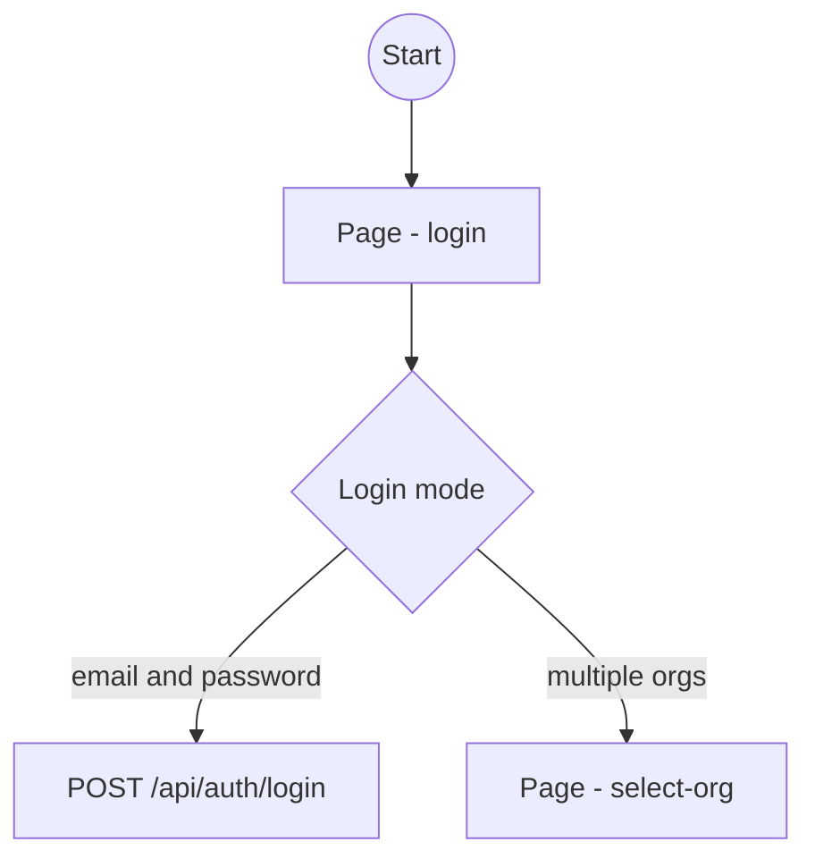
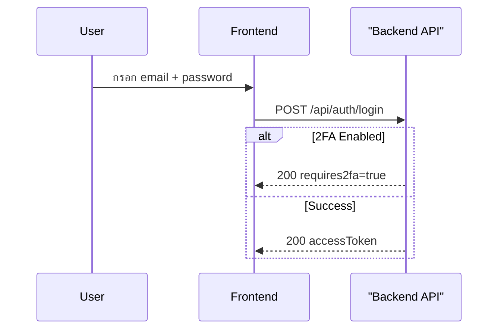

# SWC — Software Component Standard

**Project**: ...
**Version**: ...
**Last Updated**: ...

> มาตรฐานนี้ใช้สำหรับสร้างเอกสาร Software Component (SWC) ของทุก module
> ทุกคนในทีมต้องปฏิบัติตามรูปแบบนี้เพื่อให้เอกสารสม่ำเสมอและอ้างอิงได้ง่าย
> ก่อนใช้งาน ให้แทน placeholder และตัวอย่างทั้งหมดด้วย source, route, API contract, design system และ business terminology ของ target project

---

## 1. Folder Structure

```
~root/docs/SWC/
├── README.md                        ← ไฟล์นี้ (มาตรฐานกลาง)
├── auth/                              ← ตัวอย่าง: module ที่แยกตาม page
│   ├── shared.md
│   ├── images/                        ← (optional) wireframe screenshots / Figma exports
│   │   ├── page-login-desktop.png
│   │   └── page-login-mobile.png
│   ├── page-{page-name}-spec.md
└── {page-name}/
    ├── shared.md
    ├── page-{page-name}-spec.md
    ├── page-{page-name}-diagram.md
    └── page-{page-name}-wireframe.md
```

### 1.1 รูปแบบไฟล์: Per-page (มาตรฐาน)

> ทุก module ใหม่ใช้รูปแบบนี้เป็นมาตรฐาน

| รายการ | รูปแบบ | ตัวอย่าง |
|---|---|---|
| Folder | `kebab-case` | `order/` |
| Shared content | `shared.md` | `shared.md` |
| Diagram file | `page-{page-name}-diagram.md` | `page-orders-diagram.md` |
| Spec file | `page-{page-name}-spec.md` | `page-orders-spec.md` |
| Wireframe file | `page-{page-name}-wireframe.md` | `page-login-wireframe.md` |
| Wireframe images | `images/{page-name}-{variant}.png` | `images/page-login-desktop.png` |

**กฎการตั้งชื่อ `{page-name}`:**
- ใช้ path ของ page เป็นชื่อ เช่น `/login/2fa` → `login-2fa`
- kebab-case เสมอ: `/select-org` → `select-org`, `/forgot-password` → `forgot-password`

### 1.2 `shared.md`

`shared.md` เก็บ content ที่ **ทุก page ใช้ร่วมกัน** ไม่ซ้ำซ้อนในแต่ละ `page-{name}-spec.md`

| Section | เนื้อหา |
|---|---|
| Composable | `useXxx.ts` methods + Pinia state interface |
| Business Rules | Token management, Route guard, Role-based UI, Rate limit |
| Components | Component table + behavior ที่ซับซ้อน |
| Error Handling Summary | Error scenarios ระดับ module |
| Pages Overview | ตาราง overview ทุก page ใน module |

แต่ละ `page-{name}-spec.md` ต้องมี link อ้างอิงไปที่ `shared.md` ใน header:
```markdown
<!-- validate-skills: example -->
**Ref Shared**: [shared.md](./shared.md)
```

---

## 2. แหล่งข้อมูลที่ต้องอ้างอิง

ก่อนเขียน SWC ทุกครั้ง ต้องอ่านเอกสารเหล่านี้ก่อน:

| เอกสาร | ใช้สำหรับ |
|---|---|
| Requirements / REQ / AC | วัตถุประสงค์ ขอบเขต behavior และ acceptance criteria ที่ต้องการ |
| Current source, routes และ tests | พฤติกรรมปัจจุบัน component ownership และข้อจำกัดจริง |
| API contracts / backend specs | request, response, error และ side effects ที่ frontend ต้องรองรับ |
| Figma / design system / target-project docs | layout, interaction, tokens, accessibility และ project conventions |
| `work/{วันที่}-{project}.md` หรือ feature workspace | solution plan, decisions, verification และงานที่อยู่ใน scope |

---

## 3. ไฟล์ `xxx-diagram.md`

### 3.1 วัตถุประสงค์

แสดง **Flow Diagram** และ **Sequence Diagram** เพื่อให้ Frontend Developer เข้าใจ:
- User journey ระหว่าง pages
- ลำดับ API call ระหว่าง Frontend ↔ Backend
- เงื่อนไข branch ต่างๆ (error, loading, success)

### 3.2 โครงสร้างไฟล์

```markdown
# {Module} — Flow & Sequence Diagrams

**Module**: {ชื่อ Module} (Phase {N})
**Pages**: `/{page1}`, `/{page2}`, ...
**Last Updated**: YYYY-MM-DD

---

## 1. Overall {Module} Flow Diagram
## 2. {Feature} Flow — Sequence Diagram
## 3. {Feature} Flow — Sequence Diagram
...
```

### 3.3 กฎ Diagram

#### Overall Flow Diagram
- ใช้ `flowchart TD`
- แสดง user journey ข้าม pages ทั้งหมดของ module
- แสดง branch ของ API response (success / error / redirect)
- 1 diagram ต่อ module

#### Sequence Diagram
- แยก 1 diagram ต่อ 1 feature / flow ที่ซับซ้อน
- แสดง participant ทุกฝ่ายที่เกี่ยวข้อง: User, Frontend, API, External services
- ใช้ `alt`/`else`/`end` สำหรับ conditional flow
- ใช้ `Note over` สำหรับ context note

### 3.4 Mermaid — syntax (ใช้ Mermaid ปัจจุบัน 11.x)

- ใช้ `flowchart TD` / `flowchart LR`, `sequenceDiagram` (ใช้ `participant` หรือ `actor` ได้), `stateDiagram-v2`, `erDiagram`
- ชื่อที่มี underscore ใช้ได้ (เช่น `TABLE_A`, `VARCHAR_255`)
- ข้อความ label ที่มีอักขระพิเศษ (`/`, `:`, `=`, `>`, `{}`, `()`, `→`) ให้ครอบด้วยเครื่องหมายคำพูด `"..."`
- ไม่ใส่ `
` ใน label; ถ้าต้องการหลายบรรทัดให้ใช้ `<br/>` หรือเขียนให้สั้นลง
- เปิด render ตรวจทุกครั้งก่อนอ้างว่า diagram ใช้ได้





---

## 4. ไฟล์ `xxx-spec.md`

### 4.1 วัตถุประสงค์

อธิบาย **เงื่อนไขรายละเอียด** ที่ Frontend Developer ต้องรู้สำหรับ implement จริง:
- UI Conditions (แสดง/ซ่อน element ตาม state)
- Click Flow step-by-step (ผู้ใช้กดอะไร → เกิดอะไร → แสดงอะไร)
- API Contract (method, endpoint, request body, response shape, error codes)
- Business Rules ที่ Frontend ต้องรู้
- Component ที่ต้องสร้าง + พฤติกรรม

### 4.2 โครงสร้างไฟล์

```markdown
# {Module} — Component Spec

**Module**: {ชื่อ Module} (Phase {N})
**Pages**: `/{page1}`, `/{page2}`, ...
<!-- validate-skills: example -->
**Ref Diagram**: [xxx-diagram.md](./xxx-diagram.md)
**Last Updated**: YYYY-MM-DD

---

## 1. Pages Overview
## 2. Page: `/{path}`
   ### 2.1 UI Conditions
   ### 2.2 Click Flow
   ### 2.3 API
   ### 2.4 Screen Workflow
## 3. Page: `/{path}`
   ...
## N. Composable: `useXxx.ts`
## N+1. Business Rules
## N+2. Components
## N+3. Error Handling Summary
```

### 4.3 Section: Pages Overview

ตาราง overview ทุก page ใน module นี้

```markdown
| Page | Path | Layout | Auth Required |
|---|---|---|---|
| Login | `/login` | `auth.vue` | No |
| Dashboard | `/dashboard` | `default.vue` | Full Token |
```

**Layout values:**
- `auth.vue` — หน้า login / public ไม่มี sidebar
- `default.vue` — หน้าหลักมี sidebar + topbar

**Auth Required values:**
- `No` — public endpoint
- `Partial Token` — ต้องมี token แต่ยังไม่มี orgId
- `Full Token` — ต้องมี token ที่มี orgId + role
- `No (token in query)` — ใช้ query param แทน JWT

### 4.4 Section: Page Detail

แต่ละ page ต้องมีครบ 3 subsection:

#### UI Conditions

ตารางแสดงว่า state ไหน → แสดง/ซ่อน/disable อะไร

```markdown
| Condition | แสดง/ซ่อน |
|---|---|
| กำลัง submit | ปุ่ม disabled + spinner |
| Error `ERROR_CODE` | แสดง inline error "ข้อความ" |
| role = viewer | ซ่อนปุ่ม Create/Edit/Delete |
```

**กฎการเขียน UI Conditions:**
- ครอบคลุม: loading state, error states ทุก code, empty state, role-based visibility
- Error code ใช้ backtick: `` `ERROR_CODE` ``
- ระบุตำแหน่ง: inline / banner / toast / modal

#### Click Flow

เขียนเป็น numbered steps ใน code block

```markdown
\`\`\`
1. User กระทำอะไร
2. FE: validate / check อะไร
   → ถ้า error: แสดงอะไร ไม่ส่ง API
3. FE: เรียก METHOD /path {body}
4. Response:
   a. Success case
      → ทำอะไรต่อ
   b. Error case
      → แสดงอะไร
\`\`\`
```

**กฎการเขียน Click Flow:**
- เริ่มจาก user action เสมอ
- ระบุ Zod validation ก่อน call API ทุกครั้ง
- แสดง branch ทุก case (success + errors ทุกตัว)
- ใช้ `→` เป็น indicator ภายใน code block ได้ (ไม่ใช่ Mermaid)

#### API

ตารางแสดง API ที่ page นี้ใช้ + response shape สำคัญ + error codes

```markdown
| Action | Method | Endpoint | Request Body |
|---|---|---|---|
| ชื่อ action | POST | `/api/path` | `{field1, field2}` |

**Error Codes:**
| Code | HTTP | UI Action |
|---|---|---|
| `ERROR_CODE` | 4xx | ทำอะไร |
```

#### Screen Workflow

แสดง flow การทำงานของแต่ละ page แบบ ASCII diagram (ไม่ใช้ Mermaid)

```markdown
\`\`\`
┌─────────────────────────────────────────────┐
│  [Screen: /path]  เข้าหน้า                  │
│  → เรียก API หรือ action แรก                │
│                                              │
│  ⏳ Loading                                  │
│     └─ แสดง loading state                   │
└─────────────────────────────────────────────┘
         │
         ▼
┌─────────────────────────────────────────────┐
│  Response / State                           │
│  ├─ success case → แสดงอะไร                │
│  └─ error case  → ทำอะไร                  │
└─────────────────────────────────────────────┘
         │ (success)
         ▼
┌─────────────────────────────────────────────┐
│  [Screen: ชื่อ State]                       │
│                                              │
│  ├─ 🔍 Action 1                              │
│  │    └─ เรียก API / navigate               │
│  │         ├─ success → ผลลัพธ์            │
│  │         └─ error   → แสดง error         │
│  └─ Action 2                                │
│       └─ ...                                │
└─────────────────────────────────────────────┘
\`\`\`
```

**กฎการเขียน Screen Workflow:**
- ใช้ box `┌─┐` แทนแต่ละ **screen state** (loading / empty / content / error)
- ใช้ `├─` / `└─` แทน branch ของ user action หรือ response
- ใช้ `▼` แทนการ flow ต่อระหว่าง state
- ใช้ `→ [/path]` เมื่อ navigate ออกไปหน้าอื่น
- ต้องครอบคลุม: loading state, success, error ทุก code, navigate ออก
- **ห้ามใช้ Mermaid** — ใช้ ASCII เท่านั้น เพื่อให้อ่านได้ใน editor ทุกตัว
- emoji icon ช่วยบอกประเภท action: 🔍 search, ➕ create, ✏️ edit, 🗑️ delete, 👁️ preview, 📋 duplicate, 💾 save, 📧 email, ⬅️ navigate back

---

### 4.5 Section: Composable

```markdown
## N. Composable: `useXxx.ts`

### Methods
| Method | Calls | Returns |
|---|---|---|
| `methodName(params)` | METHOD /endpoint | `ReturnType` |

### State (Pinia: `useXxxStore`)
\`\`\`typescript
interface XxxStore {
  field: type
}
\`\`\`
```

### 4.6 Section: Business Rules

เขียนเป็น subsection ตามหัวข้อ เช่น:
- Token Management
- Route Guard
- Role-based UI
- Validation Rules
- Rate Limit

### 4.7 Section: Components

ตารางสรุป components ที่ต้องสร้าง + ความรับผิดชอบหลัก
และอธิบาย behavior พิเศษของ component ที่ซับซ้อน

```markdown
| Component | ใช้ใน Page | ความรับผิดชอบ |
|---|---|---|
| `XxxForm.vue` | `/path` | form fields + validation |

### `XxxComponent.vue` Behavior
\`\`\`
- กฎ/พฤติกรรมพิเศษที่ต้อง implement
\`\`\`
```

### 4.8 Section: Error Handling Summary

ตารางสรุป error scenarios ระดับ module

```markdown
| Scenario | HTTP | Frontend Action |
|---|---|---|
| Network error / 5xx | — | toast "เกิดข้อผิดพลาด กรุณาลองใหม่" |
| 401 ทุก protected route | 401 | interceptor → refresh → retry → redirect /login |
```

---

## 5. ไฟล์ `xxx-wireframe.md`

### 5.1 วัตถุประสงค์

แสดง **UX/UI mockup / wireframe** ของหน้านั้น เพื่อให้:
- Designer และ Developer มี shared visual reference
- เห็นโครงสร้าง layout, สี, typography, screen states ในที่เดียว
- รองรับ responsive variations (desktop / mobile / tablet ตามจำเป็น)

> **ขอบเขต — สำคัญ:** Wireframe เน้น **visual** เท่านั้น — behavior / business rules / click flow ให้อยู่ใน `xxx-spec.md`
> ห้ามใส่ section ซ้ำกับ spec (Components Breakdown / Click Flow / API table / Notes for Developer / Related Files)

### 5.2 โครงสร้างไฟล์

```markdown
# Wireframe: `/{path}`

**Module**: {Module Name}
**Path**: `/{path}`
**Layout**: `layout.vue`
<!-- validate-skills: example -->
**Ref Spec**: [page-{name}-spec.md](./page-{name}-spec.md)
**Ref Diagram**: [page-{name}-diagram.md](./page-{name}-diagram.md)
**Status**: Draft / In Review / Approved / Implemented
**Version**: 1.0
**Designer**: @name (หรือ —)
**Reviewed by**: @name (หรือ —)
**Figma**: {link หรือ —}
**Last Updated**: YYYY-MM-DD

---

## 1. Overview
## 2. Visual Layout
   ### Desktop (≥1024px) — Figma link + image embed + ASCII summary
   ### Mobile (<1024px) — Figma link + image embed + ASCII summary
   ### Tablet (768px–1023px) — เฉพาะหน้าที่ layout เปลี่ยนเด่นชัด
## 3. Interaction States
## 4. Copy & i18n Keys
## 5. Design Tokens
## 6. Accessibility Notes (optional)
```

### 5.3 กฎ Wireframe

#### Status field (บังคับ)

ระบุ stage ของ wireframe เพื่อให้ทีมรู้ว่ามาตรฐานปัจจุบันคืออะไร:

| Status | ความหมาย |
|---|---|
| `Draft` | กำลังออกแบบ ยังเปลี่ยนแปลงได้ |
| `In Review` | ส่งให้ team ตรวจ |
| `Approved` | designer + dev อนุมัติ พร้อม implement |
| `Implemented` | code มีแล้ว — wireframe สะท้อนผลจริง |

#### Version field (บังคับ)

bump เมื่อ design เปลี่ยน — track design history:
- `1.0` initial
- `1.1` minor tweak (สี/copy)
- `2.0` major rework (layout / flow เปลี่ยน)

#### Visual Layout (Section 2)

- **ใช้ ASCII art + image embed คู่กัน** — ASCII = git-diffable summary, image = high-fidelity (จาก Figma export)
- รูปอ้างผ่าน relative path: `./images/page-{name}-{variant}.png`
- ASCII art ใช้ box `┌─┐` + `│` + `└─┘` ไม่ใช่ Mermaid
- Annotate ตำแหน่งสำคัญด้วย `←` arrow + text
- รองรับ responsive อย่างน้อย **Desktop + Mobile**

#### Interaction States (Section 3)

ตารางครอบคลุม element interactive ทุกตัว:

| Element | Default | Hover | Focus | Active | Disabled | Loading | Error |
|---|---|---|---|---|---|---|---|
| Input | ... | — | ring + border | — | grayed | — | red border |
| Button | ... | darker bg | pressed | — | grayed | spinner | — |
| Link | ... | underline + color shift | ring | — | — | — | — |

#### Copy & i18n Keys (Section 4) — บังคับ

list ทุก user-facing string + i18n key proposed + current status (hardcoded / migrated):

```markdown
| Element | TH | EN | i18n Key | Status |
|---|---|---|---|---|
| Heading | ... | ... | `module.section.title` | ✅ migrated / ❌ hardcoded |
```

#### Design Tokens (Section 5)

ใช้ Tailwind class จริง — ไม่ใช่ generic ("blue 500" ❌ ใช้ `text-primary-600` ✅) แบ่ง:
- Colors (background / text / border / ring)
- Typography (size · weight · tracking · line-height)
- Spacing & Radius
- Breakpoint (responsive behavior)

#### Accessibility Notes (Section 6 — optional แต่แนะนำ)

สำหรับหน้าที่มี form / interactive complex:
- Focus order (Tab key)
- ARIA labels ที่ไม่ obvious
- Color contrast ratio ของ text สำคัญ
- Autocomplete attrs

### 5.4 Folder Convention สำหรับรูป

```
SWC/{module}/
├── images/                            ← screenshots / Figma exports
│   ├── page-login-desktop.png         ← layout หลัก desktop
│   ├── page-login-mobile.png          ← layout หลัก mobile
│   ├── page-login-error-state.png     ← (optional) state variants
│   └── page-login-loading.png
├── page-login-wireframe.md            ← references ./images/...
└── ...
```

**กฎ:**
- รองรับ formats: PNG (default), SVG (สำหรับ icon/diagram), JPG (เฉพาะถ้าไฟล์ใหญ่)
- ขนาด recommended: **1200-1600px** width สำหรับ desktop · **360-414px** สำหรับ mobile
- **ห้าม commit รูปขนาด > 1MB** — ถ้าใหญ่กว่านี้ ให้ใช้ Figma link แทน + commit ASCII summary
- folder `images/` เป็น **optional** — ถ้าหน้าไหนใช้ ASCII อย่างเดียวก็ได้ (ไม่ต้องสร้าง folder ว่าง)

---

## 6. Checklist ก่อน Publish

### `shared.md`
- [ ] มี Composable section (methods + state interface)
- [ ] มี Business Rules section
- [ ] มี Components table
- [ ] มี Error Handling Summary
- [ ] มี Pages Overview ครบทุก page ของ module
- [ ] ทุก `page-{name}-spec.md` มี `**Ref Shared**: <!-- validate-skills: example --> [shared.md](./shared.md)` ใน header

### `xxx-diagram.md` / `page-{name}-diagram.md`
- [ ] diagram ใช้ syntax Mermaid ปัจจุบัน และ render ได้
- [ ] Overall flow diagram ครอบคลุมทุก page ของ module
- [ ] Sequence diagram ครบทุก feature หลัก

### `xxx-spec.md`
- [ ] มี Pages Overview ครบทุก page
- [ ] ทุก page มีครบ: UI Conditions, Click Flow, API, **Screen Workflow**
- [ ] UI Conditions ครอบคลุม: loading, error ทุก code, empty, role-based
- [ ] Click Flow มีทุก branch (success + errors)
- [ ] API section มี error codes table
- [ ] Screen Workflow ครอบคลุม: loading state, success, error ทุก code, navigate
- [ ] Screen Workflow ใช้ ASCII box (ไม่ใช้ Mermaid)
- [ ] มี Composable section (methods + state interface)
- [ ] มี Business Rules section
- [ ] มี Components table
- [ ] มี Error Handling Summary

### `page-{name}-wireframe.md`
- [ ] Header ครบตาม `document-set.md` (Headers) แถว Wireframe
- [ ] Header link ไป `page-{name}-spec.md` + `page-{name}-diagram.md`
- [ ] Section 2 (Visual Layout) ครอบคลุม **Desktop + Mobile** อย่างน้อย
- [ ] ASCII art อ่านได้ — ใช้ box `┌─┐` + `│` + `└─┘` (ไม่ใช้ Mermaid)
- [ ] รูปภาพอ้างผ่าน relative path `./images/page-{name}-{variant}.png` (optional ถ้ายังไม่มี)
- [ ] รูปขนาด ≤ 1MB ต่อไฟล์ — ถ้าใหญ่กว่าใช้ Figma link แทน
- [ ] Section 3 (Interaction States) ครอบคลุม Default / Hover / Focus / Active / Disabled / Loading / Error ของ element interactive
- [ ] Section 4 (Copy & i18n Keys) list ทุก user-facing string + proposed key + current status (✅ migrated / ❌ hardcoded)
- [ ] Section 5 (Design Tokens) ใช้ **Tailwind class จริง** (ไม่ใช่ "blue 500")
- [ ] Section 6 (Accessibility) — optional แต่แนะนำสำหรับ form / interactive complex
- [ ] **ไม่มี section ซ้ำ spec.md** (ไม่มี Components Breakdown / Click Flow / API table / Notes for Developer / Related Files)

---

## 7. Module → Phase Mapping

| Module Folder | Phase | Ref in project plan |
|---|---|---|

**ตัวอย่าง**: | `auth/` | Phase 1 | Authentication Pages |

---

## 8. ตัวอย่าง Template สำหรับสร้างไฟล์ใหม่

(เทมเพลต shared.md, page-spec, page-diagram, page-wireframe อยู่ในไฟล์แยก: `templates/shared.md`, `templates/page-spec.md`,
`templates/page-diagram.md`, `templates/page-wireframe.md`. เทมเพลต component ที่ไม่มี URL อยู่ด้านล่าง)

กฎของ section 5-7 ของ page spec: section 5 ใส่เมื่อหน้ามีข้อความแปล (ถ้ามี wireframe ให้ตรงกับ Copy & i18n Keys ใน wireframe);
section 6 อัปเดตทุกครั้งที่ implement หรือเปลี่ยน ห้ามเดา (สถานะต้องมาจาก code ที่มีจริง); section 7 ลบรายการที่ปิดแล้ว
ไปไว้ใน Change Log ไม่ปล่อยค้าง. ประวัติการเปลี่ยนเขียนใน Change Log ไม่ซ้อนบรรทัด "Previous:" ใน header.

---

### Template: `{component}-spec.md` (component / feature ที่ไม่มี URL ของตัวเอง)

ใช้กับ layout shell, tab หรือ feature ภายในหน้า, component กลางที่หลายหน้าใช้. ชื่อไฟล์ไม่มี prefix `page-`;
diagram คู่กันชื่อ `{component}-diagram.md`. ใน SWC-Overview ช่อง Path ใส่ไฟล์ component หรือ `/{page}` + ชื่อ tab.

```markdown
# Component Spec: `{ComponentName}`

**Module**: {Module Name} (Phase {N})
**Path**: `{component source file}` หรือ `/{page}` → tab `{tab}`
**Layout**: {layout ที่ครอบ}
**Auth Required**: {ระดับ auth ของโปรเจกต์}
**Ref Diagram**: [{component}-diagram.md](./{component}-diagram.md)
**Ref Shared**: [shared.md](./shared.md)
**Last Updated**: YYYY-MM-DD

---

## 0. Overview

| Item | Source | Managed where |
|---|---|---|
| {ข้อมูลที่แสดง} | {API / store / prop} | {หน้าที่แก้ข้อมูลนี้} |

## 1. Layout Structure

\`\`\`
┌───────────── {ComponentName} ─────────────┐
│ [{slot / child}]          [{action}]      │
└───────────────────────────────────────────┘
\`\`\`

## 2. UI Conditions
## 3. Click Flow
## 4. API
## 5. Screen Workflow
(รูปแบบเดียวกับ page spec)

## 6. Component Details

| Component | Props | Emits | Behavior |
|---|---|---|---|
| `{Child}` | `{prop}: {type}` | `{event}` | {พฤติกรรม} |

## 7. i18n Keys
## 8. Error Handling
## 9. Open Items
## 10-13. Acceptance Criteria, Test Cases, Manual Notes, Change Log (เหมือน `templates/page-spec.md` section 8-11)
```

Module กลาง (เช่น layout): `shared.md` เพิ่ม **Composition Pattern** (component ไหนครอบอะไร), **Component Hierarchy**
(tree), และรายการหน้าที่ไม่ใช้ shell นี้. Component เล็กที่ไม่มี logic ของตัวเองอธิบายใน `shared.md` ได้ ไม่ต้องมี spec แยก.

---

## 9. List Page UI Conventions (shared) — updated 2026-09

มาตรฐานหน้าทั้งหมดให้หน้าตาสม่ำเสมอกัน:

### Filter bar


### Table


### Pagination
- ใช้ Pagination Component กลางของแต่ละ Project เป็นหลัก และ reuse existing component ก่อนสร้างใหม่
- ใช้ UI Component / Design System ของ Project แทน native element หากมีรองรับ
- per-page options ให้ยึดตาม มาตรฐานหรือ configuration ของ Project
- รูปแบบ props / events ให้เป็นไปตาม component ที่ใช้งานอยู่ในแต่ละ Project
- query parameter เช่น limit, page, perPage ให้ตรวจสอบและใช้ตาม Backend API Contract ของแต่ละ Project
