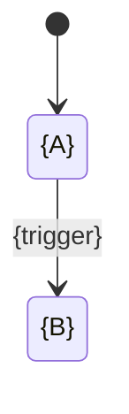

# Data Dictionary — {Module}

**Module**: {NN} {Module name}
**Owner**: {service that owns this schema}
**Version**: {X.Y}
**Date**: YYYY-MM-DD
**Source**: {วิธีที่ได้มา เช่น generate จาก schema dump ของ {environment} เมื่อ YYYY-MM-DD}

> {หนึ่งย่อหน้า: module นี้เก็บอะไร และใครเป็นผู้เขียน}

Path: `DB/Data Dictionary/{NN}_{Module}.md` ใช้ `{NN}` เดียวกับไฟล์ ER diagram regenerate พร้อมกับ ER
diagram และ index ทั้งสอง; จำนวนใน index ต้องตรงกัน version เก่าย้ายไป `_deprecated_v{n}/`
ค่าตัวอย่างเป็น placeholder ห้ามใช้ข้อมูล production

**Embedded database** (SQLite / Room-style): ใช้ storage type ของมัน (INTEGER, TEXT, REAL, BLOB; boolean เป็น INTEGER 0/1,
enum เป็น TEXT + CHECK, เวลาเป็น epoch milliseconds); เพิ่ม `Schema version` และตาราง `Migrations`
(`from` -> `to`, change, data loss Y/N) ใน header ของ module; แทน "~n rows (environment)" ด้วย "per-device"; ระบุ flag เรื่อง encryption และ backup

## Tables ({n})

| # | Table |
|---|---|
| {NN}.1 | [`{table}`](#{nn}1-{table}) |

---

## {NN}.1 {table}

> **Meaning**: {หนึ่งแถวคืออะไร}
> `PK {column}` · `Unique {columns}` · ~{n} rows ({environment})

| Field | Type | Constraints | Description | Example |
|---|---|---|---|---|
| `{id}` | {uuid / bigint} | PK | {...} | `{placeholder}` |
| `{fk_id}` | {type} | FK → `{other_table}.{id}`, NOT NULL | {...} | `{placeholder}` |
| `{status}` | {varchar(32)} | NOT NULL, DEFAULT `'{VALUE}'`, CHECK in ({values}) | {...} | `{VALUE}` |

ลำดับ constraint ในเซลล์: PK → FK → UNIQUE → NOT NULL → DEFAULT → CHECK

### 🔄 Life Cycle (only for state-machine columns)

| From | To | Trigger |
|---|---|---|
| `{A}` | `{B}` | {event / service} |

### Seeded values (lookup / master tables only)

| code | label | sort_order |
|---|---|---|
| `{CODE}` | {label} | {n} |

---

## Index file `DB/Data Dictionary/DATA_DICT.md`

| # | Module | File | Owner | Tables |
|---|---|---|---|---|
| {NN} | {Module} | [{NN}_{Module}.md](./{NN}_{Module}.md) | {service} | {n} |
| | **Total** | | | **{n}** |

Per-table index: `| # | Table (link) | Description |`.
