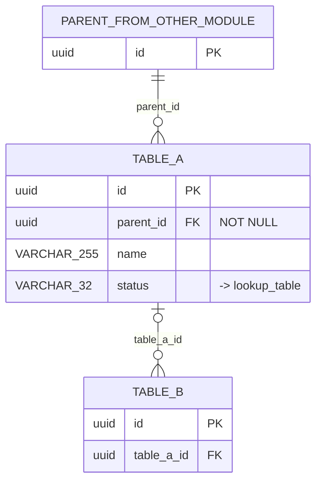

# ER Diagram — {Module}

**Module**: {NN} {Module name}
**Owner**: {service}
**Version**: {X.Y}
**Date**: YYYY-MM-DD
**Source**: [Data Dictionary {NN}_{Module}](../Data%20Dictionary/{NN}_{Module}.md)

> {one paragraph: entities in this module and their main relationships}

Path: `DB/ER Diagrams/{NN}_{Module}.md`. Mirrors the data dictionary file with the same `{NN}`.

## Diagram

Rules (replace `TABLE_A`, `parent_id` and the other sample names with the real ones):
- Types tokenised (`VARCHAR_255`, `NUMERIC_12_2`); keys marked `PK` / `FK`; constraint notes in quotes.
- `||--o{` when the FK is NOT NULL, `|o--o{` when nullable; the edge label is the FK column.
- Parents from other modules appear as PK-only stub entities.
- FKs to lookup / master tables are annotations (`"-> table"`), not edges.

## Cross-module FKs

| From (this module) | Column | To (module.table) |
|---|---|---|
| `{table}` | `{fk_id}` | {NN}.`{table}` |

## Lookup / Master References

| Table | Column | Lookup table |
|---|---|---|

---

## Index file `DB/ER Diagrams/ER_DIAGRAMS.md`

| # | Module | File | Entities | Relationships | Lookup refs |
|---|---|---|---|---|---|
| {NN} | {Module} | [{NN}_{Module}.md](./{NN}_{Module}.md) | {n} | {n} | {n} |
