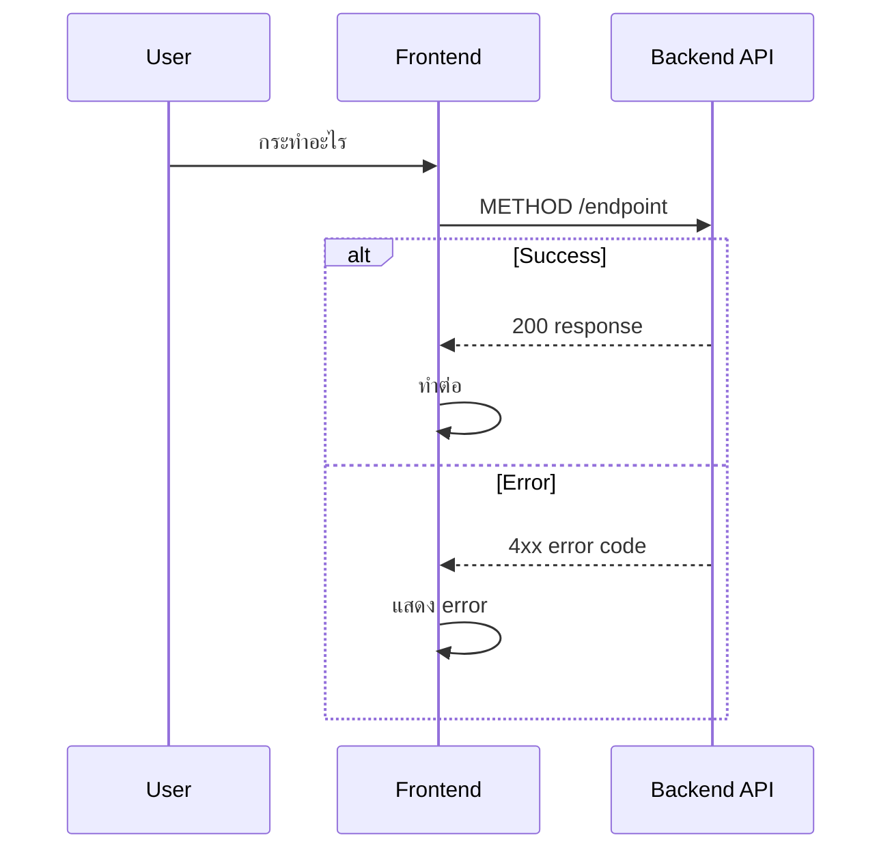

# Diagrams: `/{path}`

**Module**: {Module Name} (Phase {N})
<!-- validate-skills: example -->
**Ref Spec**: [page-{name}-spec.md](./page-{name}-spec.md)
**Last Updated**: YYYY-MM-DD

---

## 1. {Feature} Flow — Sequence Diagram

