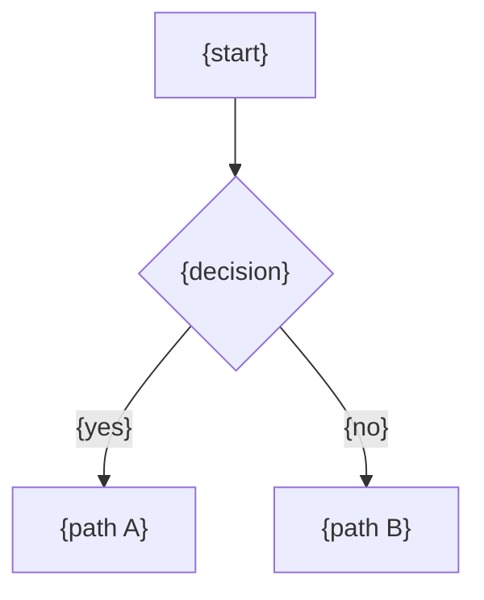
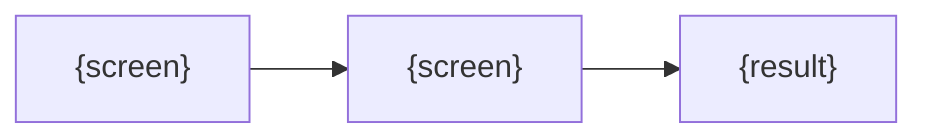

# Workflow — {Business process}

**Project**: {project}
**Last Updated**: YYYY-MM-DD
**Scope**: {ต่อ organization / ต่อ user / ทั้งระบบ}
**Level**: {business / technical}
**Tables**: [`{table}`]({relative link ไป section ใน data dictionary})

Path: `Workflow/{Process}.md` หนึ่งไฟล์ต่อ business process ที่ข้ามส่วนงาน (แหล่งเดียว ไม่มีสำเนาที่อื่น) page,
endpoint และ service ลิงก์มาที่นี่ ไม่อธิบาย process ซ้ำ

## 1. Overview

{หนึ่งย่อหน้า}

## 2. Status Lifecycle

| Status | Meaning | Editable? | Cancellable? | Deletable? |
|---|---|---|---|---|
| `{DRAFT}` | {...} | ✅ | ✅ | ✅ |
| `{ACTIVE}` | {...} | ❌ | ⚠️ {condition} | ❌ |

## 3. Permissions

| Action | {Role A} | {Role B} | {Role C} | {Role D} | Notes |
|---|---|---|---|---|---|
| {action} | ✅ | ✅ | ⚠️ | ❌ | {condition} |

## 4. Screen Flow

## 5. Paths (step by step)

### Path A — {name}
1. {actor} {action} → {ผลที่ระบบทำ}

### Path B — {name}

## 6. Sources / Inputs

| Source | Origin | Auto / Manual | Reversible? |
|---|---|---|---|

## 7. Data Reference

| Table | Columns used | Written by |
|---|---|---|

## 8. Worked Examples

| Case | Input | Result |
|---|---|---|
| {case} | {ค่า placeholder} | {...} |

## 9. Constraints

- {ขีดจำกัด, quota, กฎเรื่องเวลา}

Diagram ใช้ Mermaid (syntax: `document-set.md` Rules) ไม่ใช้ ASCII art เว้นแต่ renderer ปลายทางแสดง Mermaid ไม่ได้
