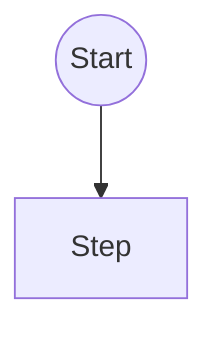

<!-- คัดลอกไฟล์นี้ไปไว้ใน docs/frontend-swc/SWC/{module}/ แล้วลบบรรทัดนี้ ลิงก์ในไฟล์เขียนตามตำแหน่งปลายทาง -->

# SWC Solution Overview — {ชื่อ module / ฟีเจอร์}

**Updated**: YYYY-MM-DD
**Audience**: Frontend, Backend และผู้ตรวจรับงาน
**Status**: Draft | In Review | Approved | Implemented
**Evidence**: Proposed
**Scope**: {ขอบเขต และสิ่งที่ไม่รวม}
**Detailed rules**: [shared.md](./shared.md)
**Traceability**: [traceability.md](traceability.md)

## 1. Goal

{เป้าหมายของงานนี้ในไม่กี่ประโยค ผลลัพธ์ที่ผู้ใช้/ระบบได้}

## 2. Current / Proposed / POC

| Level | Evidence / boundary |
|---|---|
| Current | {สิ่งที่ตรวจจาก source จริง ระบุ repo / branch / วันที่} |
| Current limitation | {ข้อจำกัดที่พบ} |
| Proposed | {สิ่งที่จะเพิ่ม/เปลี่ยน} |
| POC | {prototype ที่มี และสิ่งที่ POC ไม่พิสูจน์} |

## 3. Functional requirements

| ID | Part | Requirement / expected result |
|---|---|---|
| REQ-01 | {ส่วนของระบบ} | {ผลลัพธ์ที่ตรวจได้} |

## 4. Business rules

| ID | Rule | ที่มา |
|---|---|---|
| BR-01 | {กฎ} | {คำตอบจากผู้เกี่ยวข้อง / เอกสาร / source} |

## 5. End-to-end flow

> ใช้กฎ Mermaid v8.8.0 ตาม Frontend SWC Standard (skill `swc` → `references/frontend-standard.md`)

## 6. Security and ownership requirements

- {สิทธิ์, tenant/data boundary, ข้อมูลที่ห้ามเปิดเผย}

## 7. SWC work packages and API scope

| Part | Document | ขอบเขต |
|---|---|---|
| {ส่วนงาน} | [{ไฟล์}](./{path}) | {สิ่งที่ต้องทำ} |

## 8. Acceptance checklist

- [ ] {เงื่อนไขตรวจรับ ผูกกับ AC ใน spec}

## 9. Decisions

ดู Decision Log ใน [shared.md](./shared.md) (DEC-nn)

## 10. Open questions / deferred dependencies

- {คำถามที่ยังไม่มีคำตอบ ใครต้องตอบ}

## 11. Change Log

| วันที่ | รหัส | สิ่งที่เปลี่ยน | เหตุผล | ผลกระทบ | โดย |
|---|---|---|---|---|---|
